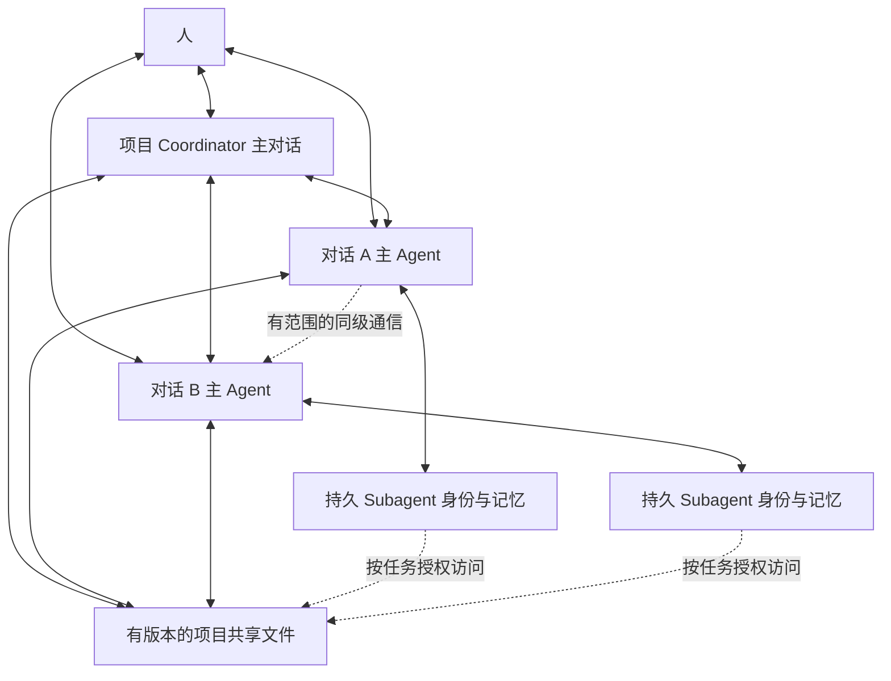

# 项目三级 Agent 协作设计与实施计划

状态：分阶段实施中的产品规格；未满足退出条件的部分仍为待实施设计。适用对象：Tofu 产品、前端、任务执行、通信和存储实现者。

代码边界：显式 owner/project 协调会话绑定与真实工作投影、同项目被动消息与明确考虑回执、本次子运行有界补充指令已具备实现。当前权威见[项目模块](../../docs/modules/conversations_project_brain.md)、[子运行](../../docs/RETAINED_AGENTS.md)、[对话消息契约](../../contracts/project_messages_v1.json)和[子消息契约](../../contracts/swarm_messages_v1.json)。文档描述该源码快照，不证明共享主分支已整合或在线服务已加载；隔离候选整合前不能声称部署可用。P2 的自动派工／空闲唤醒、完整交付闭环，以及 P3/P4 的完整退出条件仍未满足。

## 当前实现与剩余边界

| 范围 | 当前源码行为 | 尚未提供的行为 |
|---|---|---|
| 同项目消息 | 原文持久提交、幂等重试、因果回复、输入与明确考虑回执；自然准入 turn 消费 | 普通消息不自动启动执行，不授予新的付费或外部操作权限 |
| 子运行通信 | 本次委派者按 run/generation 寻址，在完整工具边界消费并核验物理请求原文 | 稳定身份 ID 不能代替运行句柄；不开放跨树私聊 |
| 消息展示 | 同一个按需工作抽屉内预览、稳定 ID 向前分页、失败可见 | 不增加三级树，不用“已接受”推断 executor 出生或交付 |
| 派工准入 | 既有握手；服务器封存私有用户执行身份，恢复校验；system 派工默认拒绝 | 非人类授权、范围／工具／预算撤销、空闲唤醒及执行出生关联仍需接通 |
| 恢复与长期责任 | 子运行终结证据、Stop 和 retained fence 的局部防护 | 项目依赖、范围变更传播、持续责任订阅及完整故障闭环待实现 |

验收入口：[消息和资源行为](../../docs/modules/conversations_project_brain.md#passive-project-conversation-messages)、`tests/project_mod/test_project_messages*.py`、`tests/swarm/test_run_messages*.py`、`tests/tasks_pkg/test_message_input_{receipts,budget}.py`、前端通信规格和本目录 `capture.py`。测试通过证明覆盖到的行为，不代替实际主仓整合、服务加载和原始目标交付证据。

本计划将一个项目文件夹中的对话视为可持续协作的 worker：每个对话主 agent 保留自己的工作上下文，通过项目文件共享长期知识，并可再次调用拥有持久身份和上下文的 subagent。项目 coordinator 在这些对话之上组织工作、传递指令、处理依赖、汇总证据与交付结果。人主要与 coordinator 和对话主 agent 交流。

近期优先形成一个项目内的完整协作闭环，再扩展到事件驱动的持续维护。已有会话、Swarm、消息队列和交付机制继续承担各自权威；本计划不声明下面的新增行为已经实现。

## 阅读入口

| 文档 | 解决的问题 |
|---|---|
| 本文 | 产品定位、三级职责、记忆、现有基础、实施顺序、评估与设计决策 |
| [通信与生命周期](communication.md) | agent 如何寻址、发消息、续交任务、确认处理、恢复、停止和交付 |
| [前端更新规格](frontend.md) | 项目入口、对话详情、通信记录、记忆与产物、交互路径和浏览器验收 |

## 1 产品模型

三级是职责结构，不要求三个常驻进程，也不要求每项工作都经过三次模型调用。一个对话可以在项目层充当 worker，同时在自己的执行树中充当主 agent。

| 层级 | 稳定身份 | 自己负责的事 | 主要记忆 | 人的默认入口 |
|---|---|---|---|---|
| 项目 coordinator | owner 与项目绑定的协调会话 | 接收目标、选择对话、拆分与续交、依赖和冲突协调、整体验收与汇总 | 协调对话的工作上下文、项目决策和任务证据入口 | 项目主对话 |
| 对话主 agent | owner 下的 conversation ID | 承接明确责任、实施与局部验收、调用 subagent、回复协调消息 | 本对话历史与压缩后的工作集、引用的共享文件 | 现有普通对话 |
| 持久 subagent | 现有 retained agent ID 与 scope | 有边界的专业任务、沿保存上下文继续、向本次委派者报告 | 身份对应的工作 checkpoint，加本次任务的新上下文 | 默认由主 agent 代理；可检查证据 |

协调会话本身具有普通会话身份，但在项目 roster 中标记为协调角色，不能把自己当成下级接收同一个指派。项目中可以有多个目标和多个 worker；近期一个显式激活的协调角色简化指令冲突，身份仍按 owner 与项目隔离。

### 1.1 项目文件夹和 worker 不是同一种身份

沿用现有项目归属、路径规范化与重命名机制。文件夹是代码和知识位置，会话是协作对象，物理 task 是一次执行。多仓库根目录是项目资源，不能因当前 cwd 相同就推断会话归属。

现有项目对话可列入候选 roster，不自动触发付费执行。归档、只读、跨 owner、已删除或不适合执行的对话明确标记，不因为出现在列表里就获得可派工权限。角色名称是描述，不是工具授权。

### 1.2 用户交付的是责任

示例：用户要求“优化启动速度，保持存储语义不变”。Coordinator 可以将性能定位续交给已有性能对话，将前端首屏改进交给前端对话，将验证交给独立检查对话。各对话可以继续找曾经研究过相关模块的 subagent。

用户随后在前端对话中说“先不改启动动画”，影响项目范围的决定需要回到 coordinator。Coordinator 根据影响更新其他指派，并解释哪些任务继续、哪些需要调整。消息、执行和交付均可追踪。

## 2 记忆设计

“短期”指当前工作的上下文范围，不表示数据只在内存中。对话原始记录和 checkpoint 仍可持久保存；模型每次调用只恢复必要工作集。

| 记忆 | 内容 | 写入和读取原则 |
|---|---|---|
| Coordinator 工作记忆 | 当前目标、指派、依赖、用户决策、待核实事项 | 从协调会话和已提交证据恢复，不装入所有 worker 原始日志 |
| 对话工作记忆 | 当前问题、局部实现、工具证据、尚未完成的承诺 | 延续本对话已有上下文和 compaction，不为每次消息重建空白 worker |
| Subagent 工作记忆 | 专业探索、先前结果、下一次可继续的线索 | 沿用 retained checkpoint；重新核验当前权限、代码版本和环境 |
| 项目共享长期记忆 | 架构说明、测试方法、已采纳决策、研究资料与产物 | 持久文件、来源和版本；按需引用与检索 |
| 协作运行记录 | 消息回执、指派状态、取消记录和交付证据 | 由现有或扩展后的语义存储操作负责，不依赖文件描述当前状态 |

### 2.1 共享文件如何有效

优先利用项目已有 README、AGENTS、docs 和产物位置，不强加通用 MEMORY.md，也不覆盖已有目录约定。需要索引时，只记录内容用途、相对路径、版本或内容摘要、来源和更新时间。

读取采用两步：先获得小型目录与近期变化，再精确读所需文件。派工包含本次所需的引用和版本，不复制整项目文件。工具读取通过现有项目访问与所有权层完成。

Worker 可以提交新知识或文档改动。经证据验证且有采纳权限的结论进入长期文件；假设、失败实验和未经复现的报告保留其证据等级。模型写的文件不会因为位于 docs 就成为权限或系统指令。现有 Project Brain Charter 的 checker 规则继续有效，不能用普通记忆文本绕过。

### 2.2 并发和失效

独立工作树里的文件修改，在整合前属于候选知识。对外声称“项目已采纳”必须关联实际整合回执。其他 worker 默认读已整合版本；明确依赖候选结果时携带候选版本引用。

同一共享文件并发修改走已有文件修改和 Git 整合机制，不最后写入覆盖。恢复旧 subagent 时提示其上次观察的代码和文档版本；历史观点保留，当前事实重新核实。文件重命名、删除和过期引用应显示失效状态与替代入口。

## 3 能力边界与授权

- Coordinator 的常规动作是交流、查阅、指派和检查回执；长时间 shell、浏览器或重型分析交给 worker。简单解释无需委派。
- 读取 worker 的摘要不意味着获得它的全部上下文。精确取证走 owner 与项目校验的受控读取。
- 用户授权按任务范围与来源传递；coordinator 或其他 agent 的消息不得伪装成人类输入。
- Worker 的报告不能自授验收通过；整体交付需要匹配原始目标和实际整合证据。
- 只读咨询、任务指派、改变方向、取消任务和外部发布分别处理，不能用一种“消息”隐含所有权利。
- Subagent 的持久身份可再次指派，但不会拥有永久工具权限，也不会因为旧记忆而恢复已撤销授权。
- 关闭浏览器不等于取消；服务重启、设备离线、上下文丢失和人类 Stop 分别显示。

## 4 现有基础与新增缺口

本表记录本次查阅的实现入口，实施前应再核验当前版本。

| 领域 | 已有基础 | 本计划需要补齐 |
|---|---|---|
| 对话与执行 | [任务引擎](../../docs/modules/task_engine.md)、[会话同步](../../docs/contracts/CONVERSATION_SYNC_V3.md) | 跨对话任务与原始请求关联；协调角色绑定；统一查看入口 |
| 对话间消息 | [持久 turn-source queue](../../lib/message_queue.py)、[模型 inbox](../../lib/agent_inbox/__init__.py) | 核验现有 peer 完整发送链；补消息关联、处理回执、版本和指派语义 |
| 子 agent | [持久身份契约](../../docs/RETAINED_AGENTS.md)、[retained 实现](../../lib/swarm/retained.py) | 将稳定身份与本次执行区分展示；明确忙碌时的后续指派行为 |
| 项目状态 | [Project Brain](../../docs/modules/conversations_project_brain.md) | 将现有投影用于协作概览；不能让 Board 变成执行权威 |
| 验收与交付 | [Goal 执行](../../docs/TASK_EXECUTION_MODES.md)、[项目整合](../../docs/modules/project_integration.md) | 指派局部验收和整体交付的关联；保留失败、部分产物和未整合状态 |
| 按需 coordinator | [Evolution coordinator](../../lib/evolution/coordinator.py) | 借鉴按需唤醒与 CAS，不直接把 goal 私有状态扩成通用项目状态 |
| 前端 | [会话架构](../../docs/FRONTEND_ARCHITECTURE.md)、[设计系统](../../docs/DESIGN_SYSTEM.md) | 项目主对话、任务概览、可操作阻塞、通信回执和渐进展开 |

现有 peer 消息已包含持久队列和 live inbox 接入，不能把整个通信从零重写。现有 ProjectWorkItem 表示物理工作结果，不能直接塞入长期指派的依赖、待接收和重开状态。若现有命令/Goal 模型无法承载长期指派，需在实现阶段定义一个明确的 assignment owner，并关联多个既有 task；不复制执行状态机。

## 5 实施阶段与退出条件

| 阶段 | 前端与产品交付 | 通信与执行交付 | 完成证据 |
|---|---|---|---|
| P0 基线与契约 | 梳理现有项目对话、peer、Swarm 和交付入口；确定原型状态 | 验证现有发送、重放、停止、权限和 retained 路径；定义新增字段 owner | 三类基线任务、现有失败场景清单、契约评审及真实数据字段映射 |
| P1 三级可见 | 项目协调入口、对话 worker 列表、subagent 详情、查看通信和交付来源 | 先投影现有事实；只开放后端已支持动作 | 无虚构运行/送达状态，刷新重连一致，旧数据可读 |
| P2 有效协作 | 从 coordinator 指派与续交；从 worker 回复；人继续交流；可操作请求 | 单项目持久派工、去重、安全边界注入、空闲唤醒、回执和子身份续交 | 端到端完成派工、执行、反馈、返工、验收、整合 |
| P3 可靠连续性 | 展示未确认消息、部分失败、恢复、范围变更与停止结果 | 崩溃窗口恢复、generation fence、优先级、依赖循环、冲突、取消传播 | 故障注入与并发测试通过，未确认副作用不自动重放 |
| P4 记忆与持续责任 | 共享文件入口、候选/已采纳知识、订阅与通知设置 | 版本引用、按需检索；复用 scheduler 做显式授权的事件/定时任务 | 旧 worker 复用收益、记忆失效处理、订阅取消和设备离线验证 |

P1 可以先提供证据型前端改进，但不能上线一个只有 coordinator 外观、没有可靠指派回执的“自动协作”承诺。P2 单项目闭环是第一项完整产品目标。跨项目 agent 市场、自动组织层级与多人协作不纳入首版。

每阶段先更新机器可读契约，再生成客户端并修改实现与所属 docs。运行时文档只描述已落地行为；本目录保留尚待实施的规格，已落地部分改为权威契约链接。

## 6 如何利用机制

| 场景 | 对话级分工 | 持久 subagent 的价值 | 协调者需要判断 |
|---|---|---|---|
| 性能优化 | 性能定位、后端实现、前端实现、独立测量 | 继续找熟悉某模块和测量环境的专家 | 瓶颈证据是否一致、改动是否整合、收益是否可复现 |
| 多模块迁移 | 按模块或仓库拆分，公共接口先行 | 重用已经理解某模块迁移约束的执行者 | 依赖顺序、重复修改、兼容性和整体回归 |
| 资料调研 | 各对话长期负责一个主题，结论可互相质询 | 保存来源轨迹与未完成线索 | 时效、来源冲突、证据覆盖和下一步问题 |
| 产品迭代 | 需求、交互、实现、浏览器验收分工 | 保持某控件或领域的历史上下文 | 新反馈影响哪些工作、验收是否真正覆盖用户路径 |
| 持续维护 | CI、缺陷、性能监控由不同对话承接 | 重用已经处理同类问题的上下文 | 是否在授权范围、是否重复触发、何时通知人 |

角色先由当前任务和历史经验决定，允许同一对话改变职责。不要先搭建固定人格团队再强行给它找任务。对有共享修改的强依赖任务先串行，独立研究和验证再并行。

## 7 验证与资源测量

基线采用三组同范围任务：性能优化、多文件改动、资料调研。对照现有执行方式与三级协作，固定模型选择、输入和验收条件；同时报告成本与效果，不只比较 worker 数量。

| 指标 | 测量方法与判定方向 |
|---|---|
| 原始目标完成率 | 按预先定义的检查器与交付证据判定；不以模型自述计成功 |
| 人工介入负担 | 统计纠正分工、重复解释上下文、查找结果和决定请求的次数及时间 |
| 协调响应 | worker 长工具运行期间测人类输入的接收、路由和回复 p50/p95，分队列与模型时间 |
| 协作成本 | 分 coordinator、worker、subagent 汇总 token、缓存、工具与墙钟；保持总账不重复 |
| 记忆复用收益 | 同一 agent 第二次工作与新身份对照，同时检查旧知识引发的错误 |
| 通信可靠性 | 消息遗失、重复逻辑生效、积压时间、重启恢复和未确认比例 |
| 并行整合 | 冲突次数、返工时间、重复研究与重复修改比例 |
| 前端性能 | 首屏请求、可见 DOM、事件流量、长列表滚动、切换和后台空闲成本 |

具体性能门槛在 P0 用现有基线和代表性设备确定，不能凭空宣布响应 SLA。按 host probe、provider 容量和显式用户限制决定并发；等待消息不占执行线程，空闲身份不保留模型实例。长期数据的容量、索引、归档与错误策略需记录实测大小，不能以清理缓存的名义删除用户记忆和产物。

## 8 关键决策与替代方案

| 问题 | 推荐决策 | 考虑过的替代方案及原因 |
|---|---|---|
| worker 身份如何持续 | 普通对话就是二级 worker，三级沿用 retained 身份 | 每次新建临时 worker 会丢掉已有局部上下文 |
| coordinator 是否常驻 | 有持久会话身份，事件到来时通过既有任务引擎唤醒 | 独立 daemon/model loop 增加空闲开销和第二生命周期 |
| 共享记忆如何存放 | 项目文件保存知识；运行记录用语义存储 | 全量共享 transcript 增长快；文件消息箱缺少可靠回执 |
| worker 能否相互通信 | 允许有范围的咨询和依赖协商，影响项目的决定通知 coordinator | 完全中心路由造成瓶颈；任意互相派工容易循环与越权 |
| 人是否直接找 subagent | 默认找主 agent，保留 inspect 与经主 agent 续交入口 | 默认多人聊天式入口扩大心智负担并模糊责任 |
| 如何维护任务状态 | 既有 task/turn 权威，长期指派关联它们 | 浏览器或 Project Brain 单独维护执行状态会产生分歧 |

## 9 实施前仍需验证的选择

1. 协调角色绑定现有会话还是创建专用会话类型：推荐复用会话基础设施并显式标记角色；验证现有导航和删除恢复语义后确定。
2. 通信回执如何扩展现有 peer/turn-source 契约：先逐一确认当前字段和持久边界，再决定最小兼容扩展。
3. 项目 scope 的 retained 身份是否允许多对话共用：现有 scope 可承载，但首版默认由创建对话代理使用；显式借用要串行预约、披露上下文可见范围。
4. 共享文件索引使用哪些已有知识能力：首版路径和版本引用优先，测得检索需求后再选语义索引，避免先建第二知识库。

这些选择不阻止 P0/P1 设计工作；进入对应写入和派工实现前必须完成契约决策。

## 10 产品参考

- [Claude Projects 改版，2026 年 9 月 17 日](https://claude.com/resources/articles/projects-redesigned)：项目主对话协调执行 thread、共享记忆和 Library。
- [OpenAI dots 任务与记忆](https://learn.chatgpt.com/docs/dots/tasks-and-memory)：后台分工、持续交流、任务上下文与长期笔记的区分。
- [OpenAI dots 控制](https://learn.chatgpt.com/docs/dots/controls)：行动授权、主任务/子任务/订阅不同停止范围。
- [Cursor Projects，2026 年 9 月 10 日](https://cursor.com/blog/projects)：专注协调的项目入口、共享上下文和订阅式维护。
- [Anthropic 多 agent 研究工程](https://www.anthropic.com/engineering/multi-agent-research-system)：并行探索、上下文隔离、明确委派与经济边界。

以上产品事实来自本次讨论中的官方资料，三级对话 worker 结构和本计划中的新增协议是 Tofu 的设计建议，不声称竞品采用相同内部实现。
