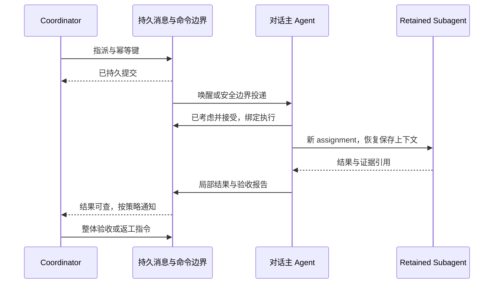

# 项目 Agent 通信与生命周期设计

状态：被动消息和本次子运行通信已有源码实现；派工／唤醒、项目取消传播与持续责任仍为待实施规格。与[总体计划](README.md)共同阅读；[前端规格](frontend.md)使用这里的语义。下列未来字段只有进入所属机器可读契约并生成后才成为 API；本文不证明候选已经整合或在线加载。

当前实现：`send_project_message/get_project_messages/consider_project_message` 提供持久的单项目被动消息和明确考虑回执；不会经过旧 `_peerNoWake` 队列唤醒分支，自动派工仍未开放。消息在接收者下一次合法运行中进入完整工具边界，不因消息重新启动已停止会话。协调绑定的 `sendMessage` 仍不承诺自动投递/唤醒，不得宣称跨对话派工已完成。运行中子消息已实现独立的 `send_agent_message/get_agent_messages`，`steerSubagent=true` 仅描述后端支持，不是权限授权。机器契约见[子消息](../../contracts/swarm_messages_v1.json)和[对话消息](../../contracts/project_messages_v1.json)，当前权威见[运行消息](../../docs/RETAINED_AGENTS.md)及[协调绑定](../../docs/modules/conversations_project_brain.md)。

子 Agent 通信需要设计，但不能用第二个 `assign` 代替：长任务需要补充证据、收缩范围与请求收尾。已提供“本次委派者 → 本次运行”的有界 `steer/reference`，调用者必须提供当前 assignment 返回的 `agent_id/swarm_run_id`，稳定 retained ID 不能替代运行句柄；服务再校验 retained run/generation 与 parent/owner/scope。子消息回执仅为 `submitted/input_confirmed/unconfirmed`，明确“已考虑”属于独立的项目对话邮箱。持久提交后在完整工具边界消费。停止仍调用既有取消权威，不把自然语言当 Stop。终结运行不被消息唤醒，reset/abandon 后旧消息失效，agent 消息不能获得 human provenance 或扩大权限。暂不开放任意跨树私聊或子 Agent 自行相互派工。这一有界子消息增量已实现；跨对话被动往返及明确考虑回执已实现；下面涉及创建执行、自动唤醒、长期 assignment 状态与恢复的部分仍为待实施规格，不能由输入确认或声明接受推断已创建执行。

## 1 身份与寻址

每条通信显式携带 owner、project、发送者和接收者。参与者可为 coordinator 会话、普通会话或 retained subagent。会话以稳定 conversation ID 寻址，retained 身份以 agent ID、scope 和 generation 寻址，task ID 只标识一次执行。

UI 标题和角色可以修改，不能作为寻址依据。项目移动、会话改绑和归档后，发送时与消费时都重新校验范围。跨项目或跨 owner 的发送默认拒绝，不因为模型读到了某个 ID 就放行。

一个 retained 身份可以有多次 assignment run；相同身份的运行仍遵循现有 busy/CAS 约束。新对话会话与 retained 身份不是同一实体，不应互相替代。

## 2 通信拓扑

| 通路 | 允许的用途 | 限制 |
|---|---|---|
| 人 → coordinator | 项目目标、优先级、授权与整体反馈 | 保留真实 human provenance 与原始输入引用 |
| 人 → 对话主 agent | 局部指导、解释、纠错和停止 | 影响项目约束的决定需发送有来源的变更通知 |
| Coordinator ↔ 对话 | 指派、续交、咨询、反馈、回执与验收 | 仅当前项目范围，不能改写别的对话历史 |
| 对话 ↔ 对话 | 接口咨询、证据核对、依赖协商 | 首版默认不允许同级创造新项目责任或扩大授权 |
| 主 agent ↔ retained subagent | 执行有范围任务、沿上下文续交、报告结果 | 主 agent 对局部工作负责；每次重新绑定权限和执行关系 |
| Subagent → 其他对话或 coordinator | 通过本次委派者转交需求或结果 | 首版不开任意跨树写入；受控读取不得提升执行权 |

Coordinator 需要某个 subagent 的知识时，先找其所属对话，请它续交或提供结果引用。以后可以支持显式借用项目级身份，但必须有预约、上下文可见性和当前回执归属，不同时把它挂在两棵运行树下。

## 3 通信类型

| 类型 | 意义 | 是否自然触发工作 |
|---|---|---|
| consult | 请求解释、检查现有证据或提供建议 | 可触发受限回复，不隐含修改授权 |
| assign | 承接目标、范围、验收条件与交付位置 | 在权限与调度准入后创建执行 |
| steer | 改变某个已有 assignment 的方向或约束 | 在安全边界处理，必要时暂停重新规划 |
| report | 进度、部分结果、阻塞或终结报告 | 更新可读记录；按通知策略唤醒协调者 |
| question | 请求明确决定或缺失信息 | 路由给有决定权的人或 agent |
| acknowledge | 接收者已考虑消息，接受/拒绝/冲突/暂缓 | 不应再自动产生 ACK 的 ACK |
| reference | 提供文件、产物、实验或交付证据入口 | 不单独触发执行 |
| cancel | 取消有明确范围的执行或后续指派 | 使用既有取消命令权威，不只注入自然语言 |

这是语义分类，不预设要新增八个工具。实现时尽量复用既有 peer API、turn-source queue 和 retained 工具，统一收敛入口。

## 4 消息契约输入

| 字段组 | 最小信息 | 原因 |
|---|---|---|
| 身份 | message ID、owner/project、sender/recipient 的类型与稳定 ID | 去重、授权与回溯 |
| 因果 | request/assignment ID、reply-to、相关 conversation/turn/attempt | 把往返消息和物理执行关联 |
| 来源 | human/agent/runtime provenance、原始授权引用 | 避免 agent 文本获得人类授权 |
| 内容 | 类型、简短正文、目的、证据与产物引用 | 只传必要上下文；完整证据精确读取 |
| 版本 | scope/identity generation、assignment revision、文件版本 | 隔离过期指令和晚到结果 |
| 调度 | 优先级类别、唤醒策略、可选 deadline | 人类输入优先，区分通知与执行请求 |
| 提交 | idempotency key、持久提交时间、当前回执 | 失败重试可确认而不是盲目重发 |

父子关系、owner 和 provenance 由可信服务填入或验证，不能由正文自报。正文保存原始请求；摘要不能覆盖它。生产格式在契约中定义一次，工具、HTTP 和前端从该契约生成或投影。

### 4.1 指派契约

一次 assign 包含原始目标引用、当前目标版本、接收对话、明确交付、范围、禁止事项、依赖、可访问资源、验收方法和结果位置。模型路由、实际工具权限和资源限制来自当前执行准入，不能由消息正文绕过。

Assignment 是可跨 turn 继续的承诺；task 是一次实际执行。一次 assignment 可以先咨询、后实施、再返工，从而关联多个 task。必须只有一个 assignment 状态 owner；task 的运行、终结和交付仍各沿用既有权威。

### 4.2 非人类付费准入：尚未接通的安全边界

已核验入口是 `lib/conversation_sync/command_service.py` 和 `task_start.py`。
现有 accepted attempt 的登记—准备—持久 task 绑定—启动握手可以复用，
但默认 user principal／`_attended=True` 不能直接用于 coordinator 自动派工。
`inputActor`、`_initiator`、正文中的授权声明和公开 config 都不是可信执行授权。

已实现安全基础：[执行身份契约](../../contracts/conversation_execution_identity_v1.json)
和[当前边界](../../docs/PROJECT_COORDINATION.md#conversation-execution-identity-boundary)
将服务器写入的 user subject/owner/tenant 与空 task scopes 封存到 accepted attempt。
公开 config、projection、settings 不可写保留身份字段；启动前严格校验，
存在但损坏或为非人类的 envelope 不回落到 human。旧的无 envelope、明确
owner 用户路径兼容，但显式 nonhuman/false attendance 不可走该 fallback。
system principal 在新的授权权威存在前拒绝。这不表示 system 执行已开放，
更不表示完整 P2 已完成。

待实施决策：服务内部 keyword-only 参数携带经验证的非人类准入；公开
生成、resume、execute-plan 和直接 input projection 均不得写入保留的执行
身份／准入字段。接受时保存到既有 attempt 的 durable dispatch config，
恢复与 executor 启动前再次校验；不因缺失／损坏而回落为 human/attended。
owner、tenant、subject 和最小 scope 来自服务权威。模型／资源／工具路由
与准入身份证明分开；`_attended=False` 本身不保证只读咨询，需要独立工具
分区和付费范围／预算授权。只有新的有效授权命令能启动停止后的工作。

准入必须绑定：原始人类授权引用、明确 recipient、规范项目、工作范围与
禁止事项、授权 revision／撤销状态、成本约束、逻辑 command identity 及
既有 turn/attempt/task 出生证明。receipt 仅查询这些事实，不另建执行 loop。
消息被考虑与付费执行准入是两次不同的决定；声明 accepted 不能替代后者。

最小退出测试：

1. live 与重启恢复保持相同 system principal、owner、非人类来源和 false attendance；
2. public config／actor／projection 伪造不能得到执行身份、scope 或人类指导权；
3. malformed／撤销／跨项目准入在 context 构建、注册和付费调用前默认拒绝；
4. idle/human lane 优先、Stop 竞态、出生后 ACK 丢失仍指向同一 durable attempt；
5. consult 不获得修改权限，无授权 ask_human 不产生永远等待的人工阻塞；
6. native 与 SQL authority 保持相同取消、重放和预算语义，现有明确工具例外不被泛化。

这些是待实施要求，不表示保留字段、授权 repository 或自动唤醒已经存在。

## 5 消息回执与工作状态分离

消息轴：提交中 → 已持久提交 → 已投递到某次模型输入 → 已考虑。拒绝、失效、取消和待恢复是明确分支。模型输入成功与“接受任务”必须区分；具体投递确认采用当前权威调用/提交边界，并允许同一消息在重试输入中出现。

工作轴：待接收 → 已接受 → 排队/执行 → 等待依赖或决定 → 结果待验收 → 验收结论 → 交付结论。这里只描述产品概念，不修改现有 task/ProjectWorkItem 枚举。UI 组合相应事实，不能用一个字段假装全部状态。

例如“消息已送达，但 worker 拒绝：授权资源不足”和“worker 已完成，结果尚未整合”都是合法可见状态。消息发送成功不能标绿为任务完成。

## 6 接收行为

| 接收者情况 | 默认处理 |
|---|---|
| 对话空闲 | consult/assign 持久排队，由既有命令路径准入并创建 turn；普通 reference 可等待下次读取 |
| 对话正在运行 | 在完整 tool-call/tool-result 边界注入适用消息；不切开工具对，不并发启动同一对话的第二主执行 |
| 对话等待人 | 能补足当前问题的真实决定关联该问题；其他请求排队，不自动假定问题已解决 |
| 对话已停止 | 保留新消息；除非存在明确的新授权命令，不因 late report 自动重启 |
| 对话归档/删除/项目改绑 | 返回明确不可投递结果；不悄悄转给另一个会话 |
| Retained 身份空闲 | assign 恢复 checkpoint 后执行，绑定本次委派者和 run |
| Retained 身份忙碌 | 首版沿用拒绝第二 assignment 的语义；请求由主 agent 保留并解释稍后续交 |
| 服务或目标设备离线 | 显示持久待执行/设备不可用；恢复后按权限和命令状态准入 |

原始人类输入仍走 human lane 与已有优先级。Agent 消息即使用 user-role carrier 进入模型上下文，也必须标记为非人类来源，不能获得 human-steer 或新目标授权。

## 7 优先级、依赖与反馈

沿用统一队列的优先级权威，不在 UI 再造排序。人类停止与范围收缩优先处理，正常派工遵循公平调度；消息洪泛不能无限阻塞已有工作。实现前定义饥饿检测和容量拒绝行为。

Coordinator 对依赖做显式记录：任务 B 等待 A 的哪个具体产物/验收，不依赖 agent 的自然语言记忆。验收结果关联版本；A 返工时 B 的旧依赖结果变为需检查，不自动宣称 B 已失效或自动重复副作用。

同级协商出现循环等待时，记录循环和阻塞证据，交 coordinator 解开。重复进度合并为最新可读更新，但不能合并掉原始用户要求、决定、取消和终结回执。

### 7.1 人直接修改 worker 任务

局部实现细节由主 agent 接收；改变目标、项目约束、交付范围或授权时生成带原始 human turn 引用的变更通知。Coordinator 明确记录“已考虑/冲突/需决定”，再给受影响 worker 发送对应 revision 的更新。

不同时间的两条要求不总是“最后一条覆盖”。范围不同可并存，明确撤销才废止旧授权；冲突时保留原文和影响，询问用户。未确认传播期间 UI 不显示“全员已更新”。

## 8 持久化、重放与崩溃窗口

持久记录先提交，再发内存 wake hint 和 UI push。现有 inbox 是低延迟投递通道，push 是失效通知，均不能成为可靠消息的唯一存储。

采用可重试投递与幂等消费，不承诺任意工具的全局 exactly-once 副作用。为每项派工绑定同一个逻辑命令和执行出生证明；重试先查已存在执行，不能另开 worker。

| 故障窗口 | 恢复要求 |
|---|---|
| 记录已提交，wake 丢失 | 从既有队列恢复，不要求用户重发 |
| 已唤醒，执行尚未出生 | 同一命令重试准入；验证 scope、停止状态和 revision |
| 执行已出生，回执未写回 | 查权威 turn/attempt/task，补关联，不再派工 |
| 输入中已有消息，确认失败 | 保留待确认并重试同一 ID；重复输入不能再次逻辑接单 |
| 结果已提交，coordinator 未读 | 按 cursor 获取未处理报告，不重复执行 |
| 子身份被 reset/abandon | generation fence 拒绝旧记忆写回；旧证据仍按权限可查 |
| 外部副作用可能发生，回执缺失 | 显示结果未确认，先核验外部状态；不能盲目重新发送或发布 |

取消水位、用户 Stop 和权限撤销优先于恢复候选。收到晚到消息可以保存证据，不能借此重启已撤销任务。

## 9 停止、归档与清理

“停止当前回复”针对当前协调或对话 turn；“取消这项工作”针对明确 assignment 及其当前授权执行树；“停止项目全部工作”是单独命令，列出范围和回执；“停用订阅”只影响未来触发。不要把暂停某次主对话等同于已停止所有 worker。

只有取消明确所属执行树才能传播给它的 subagent。借用的稳定身份需要按具体 run 取消，不能误停另一个委派者的工作。取消不撤销已经发生的文件或外部改动，UI 提供产物与回滚入口。

归档保留记忆与结果，阻止自动指派；删除沿用现有 owner 级删除契约并处理不可投递消息。空闲数据按既有容量策略管理，不能通过静默截断未读消息解决积压。

## 10 安全、可见性与成本

服务端统一权限边界检查 send、read、assign、consume 和取证。主 agent 给子 agent 的权限不超过当前授权范围；项目共享目录也受文件访问边界约束。错误响应保留公开原因和可操作下一步。

Coordinator 获得必要报告与证据引用，不默认读所有对话私有内容。共享项目 scope 的 retained 身份可携带之前的对话上下文，跨对话复用时必须说明可见范围并验证读取权。

所有模型调用计入现有用量账本。聚合按执行身份去重，避免子 agent 的用量在主 agent 与项目层重复计费。消息流量、积压、恢复耗时与存储增长单独度量，避免把持续聊天误当成免费通知。

## 11 实现入口与验证顺序

先检查 [message_queue](../../lib/message_queue.py)、[agent_inbox](../../lib/agent_inbox/__init__.py)、[peer 注入测试](../../tests/tasks_pkg/test_peer_message_driver_loop.py)、[Swarm 消息](../../lib/swarm/messages.py)、[retained 契约](../../docs/RETAINED_AGENTS.md) 和 [运行连续性](../../docs/RUN_CONTINUITY.md)。当前代码不是新协议的完整实现；消息字段与回执的差距要逐项测定。

新增 wire 字段先进入 [API 契约](../../docs/contracts/API_CONTRACT.md)、[事件契约](../../docs/contracts/EVENTS.md) 所属机器可读源。新增存储操作通过 repository/semantic storage port；原生 TofuDB、SQLite 和 PostgreSQL 保持相同行为。不要直接修改数据库或新建旁路执行 loop。

按测试阶梯验证：

1. 最小语义：身份与 scope、消息去重、接收/处理回执、synthetic provenance、assignment revision。
2. 生命周期：live 安全边界、空闲唤醒、用户优先、已停止不复活、retained busy 和 generation fence。
3. 故障注入：每个持久提交/唤醒窗口、执行出生后断连、重复 report、权限撤销、外部效果不明。
4. 集成：单项目三层派工与续交、同级咨询、局部变更传播、验收和实际整合、重启与取消。
5. 跨后端一致性和代表性并发/消息积压测量，再执行稳定版本的广泛门禁。

验收必须包含：零未解释的消息丢失、无重复逻辑派工、失败可查、无越权唤醒，以及模型自述完成无法绕过交付证据。
