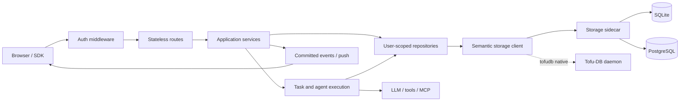

# Tofu architecture

This document is the system map. It names dependency direction and ownership;
domain contracts hold field-level behavior. Start at [the documentation map](README.md)
and follow one domain owner before editing.

## Non-negotiable invariants

1. Authentication and authorization are decided at one middleware boundary,
   default deny. A structured principal with explicit numeric owner identity
   is carried below that boundary.
2. Routes are stateless HTTP adapters. Application services own policy;
   repositories own persistence vocabulary; the storage sidecar owns SQL.
3. A domain has one command path, one durable authority, one event vocabulary,
   and one user-visible error taxonomy.
4. SQLite, PostgreSQL, and native Tofu-DB implement the same semantic storage
   operations. Application code never selects SQL or a wire protocol by backend.
5. Generated contracts are the source of wire truth. Generated consumers are
   not hand-edited.
6. Every resource has an explicit lifecycle: creation, ownership, cancellation,
   disposal, retry, and failure behavior.

`lib/agent_core/execution_session.py` is the operational lifecycle owner shared
by task-backed and bounded non-task execution. It does not replace durable task
or Turn state. It records the monotonic
`created → routed → reserved → admitted → dispatching → settling → terminal`
path, owns exact resource releases, and produces a content-free terminal
invariant receipt. Acquired resources use exception-safe bind helpers, so a
failure between acquisition and registration rolls back immediately; resource
names are a closed metric-label set and active execution IDs cannot collide.
HTTP routes may inspect/reset dispatcher state, but model
execution and provider-slot reservation must enter through a task or declared
application execution service; `scripts/check_architecture.py` enforces this.

## Runtime topology

The agent kernel has a second composition boundary, not a second execution
implementation. Embedded callers and the lightweight sidecar create explicitly
owned transient tasks and bypass persistence entirely:

```text
tofu_agent embed / sidecar
  → explicit PrincipalContext
  → transient TaskRuntime
  → shared agent execution → providers / tools / MCP
```

That process has no full-application route, repository, storage-sidecar,
billing, or frontend lifecycle. Its state is bounded process memory and cannot
survive restart. See
[DEVELOPER_RUNTIME.md](DEVELOPER_RUNTIME.md). The durable application topology
is:



The web process never opens the application database. The selected authority
owns connections, transactions, schema, maintenance, and backend adaptation. A
selected backend that is unavailable fails closed; runtime does not silently
switch stores.

Personal mode also admits a native `tofudb` backend: the same semantic storage
client speaks storage.v2 directly to a supervised `tofu-db serve` daemon, with
no Python sidecar in the hot path — the outbox relay, search projection, and
maintenance scheduler live inside the daemon. SQLite stays the default;
`tofudb` is an explicit opt-in via `TOFU_PERSONAL_STORAGE_BACKEND`. See
[STORAGE.md](STORAGE.md).

Personal mode is one `all` process plus its selected SQLite or native authority.
Distributed mode uses explicit
`api`, `worker`, and `scheduler` roles; every Pod's Sidecar connects to the same
external PostgreSQL authority, while Redis carries only ephemeral leases and
wake hints. `lib/process_roles.py` is the single lifecycle ownership table.

### Native checkpoint terminal persistence fence

**Problem:** task terminal persistence and a completed recovery frontier could
race, allowing a restart to load already-finished work. **Decision:**
checkpoint_journal::Policy::terminal_persistence wraps the existing Task port
with an owned exact-Store/lease scope. Task first joins settlement and freezes
its candidate; the wrapper CASes the same lease to terminal before delegating
persistence. Task retry rereads a committed terminal fence after lost ACK and
retains the original candidate without execution/resource replay. Owner/status,
lease-generation and scope mismatches refuse before persistence. Only a durably
committed Suspend plus Aborted candidate leaves a completed frontier; ordinary
abort and cleanup failure seal. **Alternatives rejected:** sealing after task
publication exposes a restart gap; resetting terminal debt reruns effects;
releasing uncertain leases loses authority. The wrapper retains metadata and
owned ports only, never history. It adds no store, worker or task state machine.
The two commits are ordered, not one transaction: a crash between them leaves
recovery fenced and requires existing orphan settlement. Real Agent, native
Task retry and TofuDB reopen tests cover the boundary. Application stdio/root
composition, crash takeover and whole-system performance remain pending.
### Native checkpoint persistence adapter

**Problem:** the journal Store had only a memory fixture. **Decision:** the
explicit native-runtime-checkpoints engine feature implements Store on a supplied
shared AuthorityDatabase with explicit tenant/owner and byte bounds. Header and
snapshot occupy separate owner-scoped versioned documents; CAS and snapshot
replacement share one durable authority transaction. Keep never reads the snapshot;
reads pin its header version and apply byte limits before JSON materialization.
Generic record operations cannot access the reserved namespaces. Runtime keeps
provider-json-order as its default; the DB adapter disables those defaults and
refuses a linked insertion-order Map. Provider order unification breaks existing
canonical digests, so that same-process feature combination is not admitted. No files, worker,
backend choice, automatic takeover or receipt history are introduced. **Alternatives
rejected:** another checkpoint database splits durability authority; a combined
record rewrites history on every begin; ignoring unknown commit delivery loses the
journal fence. Configured outbox captures bounded borrowed checkpoint mutations in the same
transaction; passive replay authenticates source UUID, digest and schema and
atomically applies header/snapshot plus one latest per-task witness. Current
redelivery converges; direct older/gapped/foreign deliveries refuse. An explicit
NativeCheckpointSink binds target progress to an immutable archive UUID; only
byte-identical archived records may resolve an older confirmed prefix. Source
publish_pending fetches bounded records, releases its writer during sink I/O,
then ACKs ordered durable receipts. Target commits before archive; failed archive
or source ACK joins/reopens and retries without duplicate target updates. Replaced
archives and unsupported cross-domain records refuse. Cross-domain/application
routing and default entry remain unbound. Explicit embedding, reopen/process-loss
and fault tests establish this adapter only. Stdio/application composition, SQL
adapters, terminal commit coupling and default entry remain pending.
### Native checkpoint journal transitions

**Problem:** completed snapshots alone cannot exclude a competing live owner or
an uncommitted later effect. **Decision:** checkpoint_journal owns explicit
owner/task/epoch/binding scope, versioned acquisition, lease generation and
new/completed/inflight/terminal transitions over a supplied atomic Store.
Begin commits inflight before dispatch; completion atomically publishes snapshot
and frontier. Unknown commit delivery poisons the live handle and keeps ownership
fenced. Only an explicitly joined completed/new owner may release; Drop never
releases and terminal state never resumes. Generation prevents reused-token old
handles from acquiring authority. Metadata-only transitions use Keep and never
read/copy history; bounded completion borrows the supplied snapshot. The Agent
Policy adapter requires explicit host financial/time recovery. **Alternatives
rejected:** timed lease stealing can race live effects; expiry/Drop release hides
unknown delivery; rewriting full history on begin adds context-sized work.
Two immutable schemas initialize lazily; no task cache, executor, timer, automatic
retention or backend is added. Tests cover CAS contention, corrupt/stale scope,
publication faults and Agent Suspend/resume without repeating tools. The tested
Store is an atomic memory fixture: application durable adapters, terminal-commit
composition, proven-quiescent crash takeover and default entry remain pending.
### Native checkpoint host terminal fence

**Problem:** installed checkpoint state could remain eligible after terminal persistence.
**Decision:** both policies require explicit seal before the canonical terminal writer. Rust reports committed Suspend only for Aborted candidates;
SDK freezes that marker/event/receipt, joins seal and retries without rerunning work.
Accepted seal is reused for task commit retries; ordinary abort and cleanup Error seal.
Failed/unknown load acquisition is explicitly reconciled by the policy, never guessed.
**Alternatives rejected:** deriving pause from Aborted preserves unrelated interruptions;
sealing after publication permits replay; another reader/state machine splits authority.
No history copy, worker, timer or store. Real stdio/application retry tests cover ordering, pause, fault and cancellation. Durable checkpoint policy,
default recovery and full-system performance remain pending.
### Native checkpoint stdio composition

**Problem:** the native checkpoint port could not reach an installed host.
**Decision:** optional checkpoint_control with explicit binding/round policy
uses the existing one-slot reactor for load, begin and complete. Completed state
serializes borrowed history/usage directly; validation checks metadata without
materializing a second history. Host observers enforce ordering/identity, join
cancellation/deadline work and never send expired replies into terminal carriers.
Loaded state sets the host round frontier; native counters/progress resume from
its validated checkpoint. Callback faults persist terminal evidence before SDK
cause propagation. **Alternatives rejected:** configuration-only restore lacks
ownership/account recovery; new readers split protocol authority; snapshot
capture before serialization duplicates context. Native token_admission checkpoints retain settled tokens, ordinal and usage
completeness with exact encoding/output/budget policy binding. Restoration is
one-time and refuses missing/changed account policy before HTTP; unknown usage
and exhausted budgets remain fenced. Host pricing and deadlines remain trusted
explicit responsibilities; resetting spent tokens was rejected as budget bypass. Actual stdio/TCP tests
verify Suspend, resume and failed-commit fencing; installed task tests verify
registered gateway/account settlement before completed publication. Application
checkpoint storage/default recovery and whole-system performance remain pending.
### Native completed-round recovery port

**Problem:** restarting native rounds reset history, usage, counters and progress,
and an older completed snapshot could replay an uncommitted later tool effect.
**Decision:** Agent.checkpoints binds an explicit trusted owner/task/epoch/model-
and-tool binding port. load requires an exclusive eligible completed frontier
and host financial/time recovery; begin durably fences each round before effects;
complete commits borrowed history/usage and native progress after joined tools.
A committed Suspend disposition stops before the next model call. The closed
native_agent_checkpoint_v1 schema owns serialized state. Restore refuses scope,
limit, budget, counter, shape, digest and already-halted mismatches before effects.
**Alternatives rejected:** messages-only snapshots reset finite/progress budgets;
loading an old frontier despite inflight work repeats effects; implicit credit or
clock reconstruction invents authority. History stays borrowed until an explicit
host capture; no disabled-path snapshot copy or persistent authority is added.
Stdio/application checkpoint storage and default-root recovery remain unbound;
this is native core capability, not automatic crash recovery or performance
admission. Host implementations must reject inflight and terminal frontiers.
### Project context persistence ports for native execution

**Problem:** reusable round preparation/confirmation imported host project
repositories directly, and native verified settlement omitted narrative cursor
confirmation. **Decision:** ConversationStore exposes project-message preparation,
verified message confirmation and task-bound narrative consumption. The default
adapter delegates to the existing host policy, including current coordinator
revalidation; transient tasks return before activating that persistence graph.
One confirm_consumed_project_context helper is called after verified consumption
by both loop adapters, and native accounting/cancellation still precedes it.
**Alternatives rejected:** copying project policy into core forks authority;
popping a delivery before host validation bypasses binding checks; falling back
to app repositories for an incomplete custom store violates embedding isolation.
No backend, cursor, retry, executor or durable state machine is replaced. Default
Rust entry/checkpoint migration and whole-system performance remain pending.
### Canonical native gateway progress evidence

**Problem:** installed native progress required caller-authored observations,
which could omit locally refused calls or duplicate result policy. **Decision:**
NativeGatewayProgress hashes results only after canonical gateway settlement,
keeps one bounded current batch, and checks the native call count before claiming
complete evidence. Python direct execution and root typed-failure projection use
the same pure fingerprint helpers. run_native_task binds this gateway policy from
explicit native breaker limits; gateway composition rejects a competing observer.
The observer copies only settled hashes/world version, never another history or
executor. Incomplete/mismatched/oversized batches withdraw evidence and failure
signatures; success prose grants no verification. Close releases batch and gateway
references. **Alternatives rejected:** task-history rescans grow with run length;
manual observations cannot establish gateway batch coverage; retaining full
results duplicates context ownership. A 100,000-record saturated-batch allocation
observation under a 4096-byte budget peaked at 14,879 traced bytes, retained no
result IDs after overflow, and released the gateway on close. This measures
bounded allocation, not paired latency/RSS or whole-system admission. Actual
installed context tests verify automatic evidence with the registered writer.
Default root/checkpoint migration and whole-system performance remain pending.
### Native post-tool progress stdio authority

**Problem:** the native breaker had no installed application observation port.
**Decision:** optional progress_control binds explicit trusted limits and reuses
the existing one-slot reactor for a progress_request/decision after verified
model settlement and joined tools. Frames contain owner/task/round and call count only; the
host requires exact latest-settled ordering and complete closed observation
shape. Callback cancellation/deadline signals are joined; expired decisions
never enter a later terminal carrier. Callback faults reach terminal persistence
before the SDK raises their original cause. Native Stop/expiry takes precedence
when the observation exchange fails. **Alternatives rejected:** transporting all
history duplicates preparation; a detached observer outlives task settlement;
inferring world/verification from model prose grants false progress. Actual
installed context execution verifies this port with the registered write gateway.
Checkpoint/default root migration and whole-system performance remain pending.
### Native post-tool progress control

**Problem:** native rounds lacked the shared runner's result-aware stall and
nonretryable-failure breakers. **Decision:** progress.rs owns run-local streaks;
Agent.progress binds explicit trusted limits and a joined post-tool observation.
Calls ignore response IDs/caller metadata; changed world/results, verification
and incomplete evidence reset stalls. Terminal failure signatures apply only to
fully nonretryable failed batches. Probe failures and byte overflow stop before
another provider dispatch; Stop takes precedence after the callback joins.
**Alternatives rejected:** repeated calls alone misclassify polls; prose is not
verification; inferring terminal failures from display text loses typed policy.
Only hashes and the bounded latest world version remain resident. Optional stdio binds explicit trusted observations;
checkpoint and default-entry migration remain pending. No performance win is
claimed without paired application measurements.
### Native retained usage across context replacement

**Problem:** prepared history replaced the native run byte charge although prior
provider usage remained retained, allowing repeated preparation to bypass the
combined history/usage budget. **Decision:** keep an incremental usage-array
charge, including brackets and separators, and add it when admitting replacement
history. Reject oversized replacement with NotDispatched settlement before the
next provider call; later usage append uses the same combined bound.
**Alternatives rejected:** rescanning all old usage every round adds growing CPU
cost; clearing usage loses physical-attempt evidence. Context shrink releases
only history bytes. This corrects native admission; default-entry migration and
whole-system performance admission remain pending.
### Shared root context policy for native execution

**Problem:** native preparation lacked the default loop's hygiene, dynamic inbox,
project/swarm/evolution injections and post-notice admission. **Decision:**
prepare_round_context and admit_round_context own the existing ordered policy;
both loop owners call them. Native core keeps local compaction authoritative
until server controls are ported; proactive L2 also checks its existing summary
route before I/O. Verified native returns reuse deferred inbox confirmation after
accounting, while failed or cancelled settlements retain delivery debt. The host
exposes a joined settlement cancellation event; no new loop or history mirror.
**Alternatives rejected:** copying hooks creates divergent policy; confirming at
request construction loses messages on failure; inferred server capabilities can
skip local compaction without emitting supported wire controls. Default native
selection, retries and remaining application policy still require migration.

### Native preparation deadline inheritance

**Problem:** native expiry could terminalize while a host context worker kept
running or sent its obsolete round decision into the terminal input carrier.
**Decision:** prepared round requests carry one captured local CLOCK_MONOTONIC
deadline for the run. NativeContextPolicy derives its callback timeout from that
fact, cancels queued work, signals running work and joins before acknowledgment.
Worker entry and semantic-summary admission recheck expiry. The host preserves
TimeoutError after confirming native abort, and sends no expired decision.
**Alternatives rejected:** restarting a relative timeout each round extends the
budget; abandoning a thread loses ownership; late decisions corrupt terminal ACK.
Default entry migration remains pending; these controls add no worker pool.

### Native application context admission

**Problem:** native execution has no initialized Python dispatch slots, so ordinary
prompt admission could use a different model/window/tool surface. **Decision:**
NativeContextPolicy binds the issued route after output clamping, uses generated
native tool projection, and runs the canonical admission in the caller's executor.
An owner/task/model scope supplies declared and learned-shrunk windows plus actual
output reservation; finally resets the scope. Accounting remains a separate caller
policy. Owned task cancellation signals and joins preparation; frozen metadata is
released after native quiescence. Required semantic summaries need an existing
matching authorized execution pin before the canonical L2 path; absence refuses.
**Alternatives rejected:** model-knowledge fallback can exceed offering capacity;
a second compactor forks evidence semantics; unscoped summary dispatch changes
credential authority. Default root entry and full policy migration remain pending.

### Native per-round context preparation

**Problem:** frozen native history prevents application-owned context injections
and compaction from participating before each model round. **Decision:** optional
round preparation uses the existing round-request/decision slot. The host prepares
canonical messages before reservation; an attached Permit transfers the admitted
replacement, which Rust shape/byte-checks before provider dispatch. Invalid retained
history settles NotDispatched; preparation faults reach native error persistence
before the host raises their original cause. Routes, credentials, catalog and budgets
remain frozen. Large exclusive history frames finish publication on ordinary Stop
under the original deadline. **Alternatives rejected:** a second Python model loop
retains duplicate lifecycle ownership; a mirrored history state can diverge; dropping
partial frames corrupts terminal framing. Application compaction policy and default
entry selection remain separate migration work; the port does not invent either.

### Native Responses routed application execution

**Problem:** the native core could execute Responses only through direct Rust
composition. **Decision:** the stdio contract admits explicit `responses` protocol;
compiled owner routes select the canonical endpoint and bind reasoning replay only
from declared route support. Caller configuration cannot override either binding.
Installed archive tests execute registered write/image tools, replay encrypted
reasoning, and settle the actual application terminal through the selected storage.
**Alternatives rejected:** protocol guessing risks the wrong wire format; caller
replay flags widen route capabilities; interpreter fallback hides native gaps.
OAuth and hosted/program/multi-agent profiles remain unsupported. Production
execution defaults are unchanged; integration proves behavior, not a speedup.

### Native Responses request and HTTP composition

**Problem:** native Responses stream interpretation alone cannot drive a model/tool
loop; duplicating HTTP transport would create a second cancellation and pool owner.
**Decision:** `responses_request.rs` serializes the core request while borrowing
history, derives exact Unicode tool aliases, and preserves admitted reasoning and
bounded phase replay. `HttpProvider::with_responses` explicitly binds reasoning
replay support and uses the existing physical transport/consumer lifecycle.
Provider rejection retains bounded code/status metadata. Hosted, program and agent
profiles refuse before tool effects. **Alternatives rejected:** model-name inference
widens undeclared wire capabilities; dropping opaque continuity changes requests;
a second connection pool duplicates ownership. Explicit CLI/application admission
is described above. Current Python fixtures and actual TCP model/tool/model tests
prove conversion and connection reuse, not whole-system performance improvement.

### Native Responses stream interpretation

**Problem:** native provider execution cannot interpret Responses events or retain
stateless replay. **Decision:** `responses.rs` implements bounded position-bound
function slots, unambiguous item/index routing, exact argument suffix reconciliation,
visible-text prefix proofs, reasoning paragraph boundaries and authoritative replay.
Terminal text proof retains only UTF-8 character count and SHA-256 state; canonical
Chat accumulation owns actual text. The existing SSE framer and decoded-projection
seam preserve text spans, tool admission/flood checks and finish classification.
Limits, replay types and phase rules derive from retained Python authorities.
Provider error data remains available as bounded metadata; failure never becomes
success or user Stop. **Alternatives rejected:** current-slot guessing can merge
parallel tools; blindly replacing terminal text/arguments rewrites emitted facts;
collapsing recycled IDs loses response positions; keeping a second growing text
prefix wastes memory. Unknown mandatory output types refuse until explicitly ported.
The parser does not authorize hosted/program/agent effects. Core request and
HTTP/CLI routing use separate explicit composition boundaries; OAuth remains
a separate migration requirement.

### Native structured-output request conversion

**Problem:** the native Messages request adapter rejected canonical response_format,
blocking schema-constrained tasks. **Decision:** the same borrowed request owner
maps representable json_schema descriptors to output_config.format while preserving
schema content and independent effort settings. Existing format must agree;
unknown descriptor fields, non-object schema, non-schema formats and a supplied
strict value other than true refuse before transport. The retained Python converter
remains the differential oracle. **Alternatives rejected:** dropping format silently
changes the requested task; overriding conflicting native format hides policy;
adding a separate request sender duplicates lifecycle ownership. This is request
negotiation, not client-side response-schema validation. The real stdio/application
case verifies identical schema/effort on both model rounds plus terminal persistence.

### Native multimodal tool/model content

**Problem:** native tool callbacks only returned strings and Messages conversion
rejected images, preventing real image-tool continuation. **Decision:** explicit
`tool_feedback="multimodal"` and the owned gateway flag admit canonical text/image
blocks. Their closed shapes derive from the stdio schema into Rust constants and
a packaged Python contract; neither runtime reads repository schema files.
The existing Feedback text method remains the default; an explicit model-content
projection preserves arrays and charges encoded bytes before another model round.
Gateway, host and CLI retain byte bounds and joined callback ownership. Anthropic
converts user/tool image blocks, retaining order/cache placement and reconciling
MIME from a bounded decoded prefix using the existing magic-byte authority.
**Alternatives rejected:** stringifying images loses model input; admitting arrays
implicitly widens the old callback contract; fetching URL images locally changes
network/credential authority; full base64 decode adds image-sized scratch work.
Model vision capability, image provenance, immutable retention and tool execution
remain application-owned. Real registered inspect_image tests cover Chat and
Anthropic continuation, undeclared-media failure and feedback-byte refusal.

### Native Anthropic HTTP execution

**Problem:** a native stream parser alone cannot run the Messages model/tool
loop. **Decision:** `anthropic_request.rs` serializes borrowed canonical history
into Messages requests, preserving ordered system/developer policy, signed
thinking, complete opaque replay, tool results/cache markers and supported
inference fields. HTTP uses a monomorphized reader through one existing physical
connection/cancellation/consumer/drain owner. Explicit stdio `provider_protocol`
selects it; v2 routing compiles the endpoint/auth using existing leaf helpers and
prevents caller protocol override. Non-read tools still enter the existing exact
approval gateway. **Alternatives rejected:** Python per-round translation keeps
the model loop dependent on Python; cloning a full converted history adds a
second growing carrier; a parallel HTTP implementation forks timeout/Stop and
pool lifetime. Unsupported audio/video, non-schema response formats, compaction/discovery policy,
OAuth and other unported shapes fail before provider effects. This is an explicit
supported native path, not production-default promotion or a complete protocol
migration. Real stdio application execution verifies registered write, streamed
text, signed continuation and terminal durability through the selected authority.

### Native Anthropic stream interpretation

**Problem:** native provider execution only understands Chat-shaped events;
Anthropic replay blocks, signed thinking and split cache usage cannot be dropped
when migrating providers. **Decision:** `anthropic.rs` owns bounded event/block
translation and replay state over the existing SSE framer and Chat accumulator.
Decoded canonical projections enter the accumulator directly without encoding
and reparsing JSON. Stop mappings/index/name bounds derive from the Python
protocol authority through the execution-contract generator. Tool JSON fragments
append without reparsing the growing prefix; stop/terminal/EOF validates object
inputs, and requested replay snapshots remain detached and in wire order.
Hosted tools never become executable client calls. Required malformed/capacity
failures close the response; cancellation retains the existing partial-output
classification. **Alternatives rejected:** text-only translation loses protocol
continuity; ignoring hosted-tool truncation invents success; reparsing each input
prefix grows work; a second canonical tool parser duplicates execution admission.
The explicit native Anthropic HTTP/CLI composition now uses this stream owner.
Its request adapter bounds supported canonical history/policy conversion and
refuses unsupported media/features before network dispatch.

### Native model-round tool identity

**Problem:** host tool callbacks lacked the originating native model round, so
application tool records required a separate mutable round source. **Decision:**
the admitted native scheduler batch carries its zero-based round through scoped
registry dispatch and the `tool_request.model_round` frame. Host validation
rejects boolean/negative values before callbacks. NativeGateway prefers this
explicit field; an older transport may use its explicitly supplied round source,
and missing/invalid identity refuses before parsing or handler execution.
Standalone registry calls carry no fabricated model round. **Alternatives
rejected:** decoding opaque scope IDs couples formatting to policy; counting
callbacks confuses sibling tools with model rounds; provider call IDs can repeat
in different responses. The actual multi-round application fixture verifies
three model requests, two registered writes, distinct application call identities
and tool `llmRound` values 0/1 without an external round counter.

### Native application tool gateway

**Problem:** native host callbacks alone do not enter the application's admitted
registered-tool pipeline. **Decision:** `lib/tasks_pkg/native_gateway.py` binds
one explicit task, principal, prepared catalog, factual model-round source and
borrowed executor to the existing parser and `execute_tool_pipeline`. Current
project/Git admission, hooks, resolver, budgets and finalization remain canonical.
An exact live application approval receipt avoids a second prompt; changed
arguments, expired receipts and child restrictions retain existing gates.
Pending decisions reserve count/byte capacity before awaiting policy; disposal
revokes late grants. Parent cancellation signals the existing task abort event
and joins physical pipeline work before returning. Every occurrence receives a
fresh application identity. **Alternatives rejected:** direct handler callbacks
duplicate policy; a second executor duplicates resource ownership; reusing a
provider ID can collide with cached occurrences. Text feedback is supported;
text/image block feedback requires explicit multimodal admission. This bridge is a migration seam,
not a production-default switch or a measured application speedup.

### Native host tool approvals

**Problem:** native stdio rejected all non-read tools, preventing application
write execution from entering the Rust loop. **Decision:** explicit
`approval_control` and an injected host ApprovalPolicy gate non-read calls.
The existing native Store mints owner/parent/epoch/call/argument-bound single-use
receipts; Registry exposes the consumed call identity to the host handler.
The host retains a bounded detached original proof, rechecks exact name,
arguments and caller, then consumes it before invoking the admitted callback.
Read declarations alone grant no write receipt; missing policy refuses before
network effects. Ordinary denial becomes bounded model feedback, while policy
and tool executor failures stop native execution with the original host cause.
Published approval/tool requests retain their host work through response/EOF.
The host enables `tool_result_join` for admitted callbacks, signals cancellation
before joining started approval/write work and preserves explicit failed results.
**Alternatives rejected:** model-declared permission is not authority; schema
validity cannot replace a receipt; detached callbacks can mutate after terminal;
using cancel for a failed required policy fabricates a user-stop outcome.
Human, automatic and delegated decision logic and the actual tool gateway remain
application-owned. This bridge does not certify external exactly-once effects or
promote the native path to the production default.

### Native incremental text delivery

**Problem:** native provider execution returned only complete responses, losing
live text/reasoning and partial output on interruption. **Decision:** the same
bounded Chat parser mints borrowed accepted-text spans; the HTTP owner merges
adjacent same-channel spans and awaits a required consumer. Native stdio uses
owner/task/sequence-bound `text_delta` frames and explicit `text_ack` through the
existing joined reader. Published frames retain their host callback until ACK
or EOF; a rejected ACK stops the native provider before tools or terminal success.
The host joins text projection and ACK even under repeated cancellation. The
application's explicit `project_text` uses its existing event/coalescing owner
on the supplied executor; terminal durability remains a separate required ACK.
**Alternatives rejected:** reparsing SSE in Python duplicates interpretation;
copying cumulative histories for each delta grows work; dropping callbacks on
Stop permits late event writes; unacknowledged frames can overtake a failed
consumer. This explicit native entry still needs complete production protocol,
tool and orchestration policy before default promotion.

### Native runtime foundation

**Problem:** Python remains the process/execution composition owner even when
individual kernels are native. **Decision:** the root Cargo workspace and
`packages/tofu-runtime/` establish an independently executable Rust runtime
boundary. Its first owner is bounded physical job execution with byte/job
admission, atomic publication and joined shutdown. Released application/agent
compositions still use their current Python owners while domain migration is
verified. Storage/backend authority, generated API/event contracts and explicit
principal context remain the integration boundaries. **Alternatives:** extending
only Python-loaded kernels retains Python as the runtime owner; switching the
storage backend would not migrate execution and would change data authority.
Native commands and current limits live in the [crate guide](../packages/tofu-runtime/README.md).

The native `session/` owner now implements composition-scoped identity,
monotonic execution phases, deadline/cancellation signals, binding rollback and
one terminal resource receipt. Its labels/order derive from the retained Python
owner via `scripts/gen_rust_execution_contract.py`; six actual Python receipt
fixtures verify settlement semantics. Callbacks run outside state locks and
concurrent terminalizers await the same receipt. Native abandonment releases
resources as cancellation; durable task status and event publication remain
separate owners. `tofu-native check-session` exercises this native boundary.

The native `task.rs` driver now owns execution callbacks and frozen terminal
candidates over explicit persistence/publication ports. Resource settlement
precedes persistence, which precedes terminal delivery. Failed acknowledgements
retain retry debt without restarting execution or cleanup; adapters must preserve
owner/task idempotency. Terminal replay vocabulary derives from `lib/task_replay/task_replay.py`.
**Alternatives:** publishing before commit exposes uncommitted outcomes; retrying
the execution callback duplicates provider/tool effects. Production provider,
storage and SSE adapters remain pending; native tests certify this boundary only.

The native `sse.rs` owner now frames provider byte streams with explicit
event bounds, incremental strict UTF-8 and consumer-controlled cutoff. Frozen
Python oracle fixtures guard events and malformed counts across network chunks.
**Problem:** native provider execution needs faithful framing without Python
objects or callbacks across a language boundary. **Decision:** keep native framing
within the Rust runtime and leave provider completion to its consumer.
**Alternatives:** eager whole-chunk parsing diagnoses bytes beyond a terminal;
lossy UTF-8 can corrupt tool arguments. Native provider/HTTP composition is still
pending; isolated parser timings do not establish application performance.

The native `provider.rs` owner now composes SSE framing with a supported
Chat-compatible accumulation subset and explicit output/tool budgets. State
labels and failure priority derive from the Python provider result authority.
`run-chat-stream` drives stdin bytes through that owner and the native transient
task driver without Python. **Problem:** a native framer alone cannot certify
provider completion. **Decision:** preserve positive finish evidence and malformed
counts through native task settlement. **Alternatives:** accepting `[DONE]` alone
manufactures success; routing through Python preserves the hot language boundary.
Full provider translations, tool policy, usage normalization, HTTP and durable
adapters remain pending; the crate guide records the supported subset.

The native HTTP owner now supplies an awaited fixed-endpoint reqwest/rustls
connection pool and explicit proxy/timeouts, composed with provider results and
transient tasks by `run-http-chat`. Session cancellation wakes network waits;
response/drain lifetimes retain admission until quiescence. **Problem:** stdin
parsing does not migrate real provider I/O. **Decision:** one native composition
owns HTTP through terminal publication without Python or hidden transport retry.
**Alternatives:** per-request clients lose connection reuse; detached read
workers retain work after cancellation. Real TCP tests guard lifecycle behavior;
application routing, provider policy and durable composition are still pending.

The native `tool_policy.rs` owner now enforces response-position identical-call
admission and normalizes caller authority within the native stream path.
**Problem:** accepting native tool deltas without shared flood policy can adopt
a rejected provider batch. **Decision:** check complete arguments immediately
and empty calls at finalization, preserving the canonical `tool_loop` projection
and explicit operator limits. **Alternatives:** counting IDs misses fresh-ID
floods; retaining parameter trees grows state; numeric coercion merges distinct
integers. Actual Python occurrence/caller fixtures verify the native signature
semantics. Full tool reconciliation/execution remains pending in the crate guide.

The native `tool_assembly.rs` owner now reconciles unindexed/index-reused
occurrences, fresh IDs, name fragments and repeated frames against an immutable
request tool catalog. **Problem:** rejecting these gateway shapes keeps valid
provider attempts on Python. **Decision:** preserve the canonical occurrence
state machine within native streaming, including malformed recovery and opaque
extra metadata. **Alternatives:** defaulting missing indices to zero merges calls;
global ID deduplication discards distinct response positions; joining every name
corrupts complete identifiers. Actual Python fixtures guard native results; tool
schema/execution and full provider/application composition are still pending.

The native `tool_contract.rs` owner now compiles request ToolContractV2
validation and issues private, consumed dispatch proofs after explicit owner,
epoch, caller and authorization checks. **Problem:** native tool assembly alone
cannot authorize or validate execution. **Decision:** preserve the canonical
custom validation rules and recheck authorization at final dispatch.
**Alternatives:** a general JSON Schema engine changes required-null/default
semantics; treating validation as permission bypasses authority. Actual Python
fixtures verify argument transformations and error payloads. Handler adapters,
resource lifecycle composition and full agent-loop migration remain pending.

The native `tool_execution.rs` owner now wraps registry callbacks in one
resource-settled tool scope. **Problem:** native validation/dispatch alone leaves
cancellation, deadlines and resource disposal to unverified handlers.
**Decision:** use ExecutionSession for binding/cleanup and wait for callback
quiescence before returning results; preserve independent stop and failure facts.
**Alternatives:** returning on Stop releases resources still in use; detached
callbacks can mutate after terminal publication; handler-owned terminalization
forks lifecycle authority. Live Stop, cleanup fault and repeated-dispatch tests
guard this boundary. Production handler/process/output and parent-task adapters
remain migration work in the crate guide.

Native tool scopes now observe the declared parent's stop, closing and
deadline signals with owner/identity checks. **Problem:** independent tool
cancellation can leave children running after the parent stops. **Decision:**
share owned observation channels/clock and publish settlement intent before
cleanup joins; preserve independent parent-closing/cancel/deadline facts.
**Alternatives:** retaining parent sessions pins their resource lifetime;
polling/detached watchers add idle work and teardown debt; signaling after
cleanup deadlocks callbacks joining children. Tests exercise actual Task abort
through child cleanup and one aborted terminal event. Production handler and
full agent-loop composition remain pending in the crate guide.

Native `process_launch.rs` validates explicit child environment, arguments and
absolute working directories, resolves executables against the child mapping,
and clears ambient environment in the constructed command. **Problem:** native
tool adapters need a launch mapping without inheriting server credentials or
working-directory assumptions. **Decision:** preserve the retained Unix child
environment semantics and leave permission, sandbox, admission and process
quiescence to their execution owners. **Alternatives:** ambient PATH resolves a
different executable; implicit shell evaluation changes literal arguments. Real
child tests verify environment isolation, literal arguments and working directory.
This is launch preparation, not production process execution or a performance
admission; native kill/reap and application adapters remain pending.

Native `process_supervisor.rs` now runs explicit launches through one dedicated
single-threaded Linux subreaper worker. **Problem:** a process-group kill alone
leaves session-escaped descendants, while reaping its leader before signaling
can reuse numeric ownership. **Decision:** retain waitable leaders through group
termination, then kill/reap adopted descendants until ECHILD; join the worker
before returning even on callback unwind. pidfd readiness wakes normal exit,
while explicit poll intervals observe cooperative scope Stop. Binary output
frames keep raw captures out of JSON value trees. **Alternatives:** application
subreaper policy can steal unrelated children; detached readers survive Stop;
unbounded captures retain flooding output. Real processes verify caps, escape,
Stop/deadline, callback panic and resource-release ordering. This native primitive
is not sandbox admission: production namespace/cgroup, hard worker-death
containment, tool policy adapters and application cutover remain pending.

Native `process_boundary.rs` now seals descriptors and installs per-process
limits before supervisor/tool exec. **Problem:** environment isolation alone
leaves inheritable directory/socket handles, and native execution needs declared
OS ceilings without changing application policy. **Decision:** mark every handle
above stderr CLOEXEC in the forked child, using close_range when supported and
a fixed-buffer post-fork proc inventory on older kernels; preserve the exec-error
pipe until successful exec. Set no_new_privs and disable core dumps, then apply
explicit CPU/address-space/file-size/descriptor soft and hard limits only to the
tool. **Alternatives:** parent-side inventories race concurrent opens; closing
unknown handles breaks std spawn failure reporting; descriptor-number caps miss
high handles; process-global limits affect unrelated work. Real processes verify
high-FD closure, limit enforcement and unchanged parent policy. Private request
and result formats reject binary skew. Namespace/chroot/cgroup/network policy,
hard supervisor-death containment and production adapters remain pending.

Native `agent.rs` now composes multiple authorized provider rounds with the
compiled tool gateway, parent-linked tool scopes and one Task terminal driver.
**Problem:** independent provider/tool primitives do not continue a model after
actual tool execution. **Decision:** preflight complete tool shapes and lossless
argument carriers, admit/recheck each call, join tool cleanup, project feedback
through the owning policy and append it before the next provider request.
Explicit round/tool/history/feedback budgets refuse overflow; exhausted model
continuation capacity refuses tool effects. Binding/owner checks precede paid
dispatch, and cleanup failures cannot become recoverable model feedback.
**Alternatives:** terminalizing each HTTP attempt ends the agent too early;
stringifying arbitrary failures leaks private details; coercing big integers
changes tool arguments; cloning full history on every request wastes memory.
`agent_http.rs` serializes borrowed messages into a bounded request and shares
immutable callable names; parent Stop/deadline wakes silent HTTP. Real TCP tests
compose native supervised echo execution, wire feedback and one terminal event.
This transient ordered/text lane does not replace production routing, parallel
scheduling, approval/progress/multimodal projection, compaction, billing, durable
round checkpoints or application composition; those adapters remain pending.

Native `tool_scheduler.rs` now composes atomic batch admission and a private
scoped Rayon pool with the agent's existing gateway/scope owners. **Problem:**
ordered-only native tools leave independent read work serialized, while detached
parallel jobs can continue after Stop or terminalization. **Decision:** only
explicitly classified read names overlap; writes/ordered calls run by provider
position on the admitted caller lane. Reserve the whole call/byte batch before
publication; scoped jobs await all outcomes before feedback. Required cleanup
failure cancels remaining scopes and retains fatal priority; local tool Stop
propagates parent cancellation rather than empty success. Pool startup failures
join partial threads, close refuses new work then joins all workers, and self
close/worker reentrancy fail explicitly. **Alternatives:** unsafe borrowed-job
lifetime extension risks use-after-free; per-batch pools repeat startup; assuming
all reads are independent changes task-local protocols; holding result locks
while invoking handlers serializes execution. Barrier, Stop, capacity, startup
fault and concurrent-close tests verify these boundaries. Production classification,
approval/progress, compaction/billing/durable adapters and full application
performance admission remain pending.

The native tool pool now uses a private renamed Rayon-core 1.13 snapshot with
an opt-in four-round idle spin window. **Problem:** instrumented waiting-tool
batches show repeated yield/wake work in the generic 32-round idle policy.
**Decision:** retain upstream scope/latch/wake accounting, make the idle threshold
pool-local (including partial wake), and select four rounds only for the tool
scheduler. Upstream defaults and other Rayon consumers remain unchanged; the
renamed package/links and retained path dependency permit external embedding
without root patches or conflicts with upstream Rayon. **Alternatives:** zero
spin reduced CPU but regressed empty-job P99 by about 12%; per-batch pools repeat
startup; handwritten borrowed-job lifetime erasure weakens scope safety.
Three matched-process profiles retain latency/RSS while reducing waiting/empty
callback CPU; these synthetic costs do not establish full application admission.
The retained dependency includes licenses and `UPSTREAM.json` source/delta hashes;
private-core stress and upstream suites guard scope/wake behavior.

## Native per-round admission and settlement

Problem: authorizing a native invocation once cannot apply application budget
and route policy before every later model request. Decision: Agent composes an
optional round Admission port over explicit owner/task/ordinal, borrowed history
and a cancellation/deadline view. Each owned Permit settles once with Returned,
Failed, Stopped, NotDispatched or Abandoned evidence. Returned retains the raw
provider facts/usage; it never certifies known usage or grants refunds. One
required ModelRoute run resource certifies zero pending permits and no settlement
fault before terminal publication. Policy errors refuse later rounds; physical
results settle before late Stop is projected. Alternatives: checking only the
round count misses authority changes; fabricating usage/refunds invents policy;
unwind-only drop without failure certification can hide abandoned reservations.
The port supplies no terminalization authority, routing compiler or price table.
Production policy, native stdio round-control wiring and durable accounting
adapters remain pending; existing explicit transient composition is unchanged.

## Native acknowledged terminal persistence

Problem: native stdio Task always used transient persistence, so an application
host could observe completion without a durable candidate acknowledgment.
Decision: optional terminal_persistence emits one owner/task/operation-bound
terminal_request after ExecutionSession resource settlement. The host returns
terminal_ack; only accepted persistence permits Task publication. Rejected,
invalid or timed-out ACK never publishes a successful terminal event. Explicit
host retry within the configured attempt bound re-enters Task.finish using its
frozen candidate; it repeats neither provider/tool execution nor live cleanup.
The live control reader returns its bounded unread tail and restores stdin flags
when joined. An exclusive post-settlement persistence carrier handles ACK/cancel
under its own deadline, so model deadline expiry does not erase terminal debt.
Large bounded terminal frames use exclusive partial writes; no concurrent model
or tool producer remains. Alternatives: persistence after stdout publication
exposes uncommitted completion; retrying the model duplicates effects; retaining
an unjoined live reader races ACK ownership. The Python TerminalPolicy port joins
callback/ACK cancellation and verifies final event equality with the accepted
candidate. Caller-defined operation IDs must carry durable writer/idempotency
identity. A rejected/exited process leaves the host's observed candidate for its
own durable reconciliation; no process crash is treated as committed success.
This is an acknowledged durability port, not a backend or production selection.
Actual storage repositories, writer fencing and repair remain application owners.

## Native v2 route host binding

Problem: native invocations required caller-supplied endpoints/headers without a
v2 authority binding port. Decision: `lib.model_routing.native_route` reads one
explicit OwnerBoundary, reuses canonical candidate compilation and credential
secret decoding, and issues one owner-bound consumable route carrier. Provider,
access, offering, deployment, connection, credential, model reference, revision,
limits and inference metadata accompany the chosen wire model. Endpoint/header
configuration cannot override that route; generation preparation remains an
explicit trusted canonical-policy callback. Rust owns actual model/tool rounds.
The port resolves only the selected credential once, registers no global Slot,
probes no endpoint, writes no repository and automatically retries nothing.
Explicit Chat-compatible openai/local routes are supported. An unsupported
primary protocol/credential is refused before plaintext resolution instead of
selecting a different path. Secret-bearing payload has a caller-selectable bound;
repr excludes it, consumption is single-use, and host cleanup clears the owned
header carrier. Alternatives: minting pooled ephemeral Slots couples native
execution to the Python dispatcher; accepting endpoint/header overrides widens
route authority; choosing the next supported protocol silently changes selection.
Real native/TCP proof checks alias, endpoint, authorization, output cap and
model/tool continuation. Prepared inference/body policy, full protocol families,
health/snapshot accounting, egress and durable application selection remain
integration owners; this internal port is not the production default.

## Native selected local token ingress

Problem: counted HTTP had no model input counter implementation. Decision:
`token_ingress.rs` ports the selected local tiktoken tier's text traversal,
Python-compatible tool JSON and inherited message/image/request overhead into
Rust. Explicit wire-model/owner/task binding and explicit cl100k_base/o200k_base
selection replace no model-routing or resolver policy. Owned lazy Encoder Arcs
may be shared by counters and release their dictionaries at composition end;
no network, global model cache, source mutation or heuristic fallback is added.
The existing generator derives framing constants. 120 actual Python counter
fixtures match both encodings; a current-source gate executes unchanged counter
helpers with hash-verified Cargo vocabulary and an explicit bounded cache quota.
Optional native stdio token_admission selects this counter and finite account.
The CLI borrows frozen input through one scoped CPU worker with an explicit stack,
keeps the existing reactor reading cancel during cold work, and joins before
admission/terminal. Unknown usage never refunds finite authorization.
Alternatives: model-name guessing can choose the wrong vocabulary; using message
counts invents ingress; synchronous cold BPE work stalls the control reactor;
retaining borrowed work after task exit violates cleanup ownership. Pinned
`tiktoken-rs` 0.11.0 actually builds on Rust 1.85.1; 0.12.0's advertised minimum
fails its let-chain syntax check. This selected-tier port does not replace the
usage-cache/API/HF/DeepSeek resolver, production model selection, durable account
adapters or the Python application launch. It remains an opt-in composition.

## Native finite model account and HTTP ingress

Problem: native usage evidence alone does not reserve finite authorization or
constrain the physical request. Decision: `model_account.rs` owns one explicit
owner/root account with bounded actor membership, shared/local token caps,
checked attempt ordinals, atomic input/output reservations and exactly-once
settlement. Live reservations wait through the existing caller's Tokio Notify;
session Stop/deadline owns cancellation. Unsent leases may void; after dispatch,
unknown usage fences finite authority and cannot refund it. Restore is one-time
on a pristine account and grants no replay or execution authority.
`HttpProvider.with_account` composes this owner with a trusted InputCounter and
an explicitly declared max_tokens/max_completion_tokens field. It counts frozen
borrowed messages/tools, applies the admitted output cap while serializing once,
records/rechecks dispatch intent, and settles raw usage before returning. Failed
preparation voids an unsent lease; uncertain transport outcomes remain unknown.
Observers run outside locks with admission fenced until their acknowledgment;
settlement errors/panics retain consumption and fail the native request port.
Alternatives: limiting output only in a ledger leaves the HTTP request uncapped;
releasing admission before observation can spend failed durability headroom;
using message counts fabricates token ingress. 100 current Python reservation/
settlement traces and real TCP verify the boundaries. This native opt-in port
still needs a production model-specific InputCounter, route/durable-account
composition and child-membership durability; application launch remains Python.

## Native provider consumption evidence

Problem: raw native usage cannot alone distinguish known consumption from
missing counters or cache-only lower bounds. Decision: `usage.rs` ports the
canonical `lib.cost.observed_usage_totals` cleaning, aliases and cache conventions
into borrowed native observation. Aliases derive through the existing execution
contract generator; 2,409 actual Python oracle inputs and a read-only current
source gate verify behavior. Returned stdio evidence retains raw usage plus the
bounded usage_observation declaration. No estimate becomes consumption.
Alternatives: summing every cache field double-counts OpenAI input; filling absent
counters with known zero permits invalid refunds; crossing into Python for each
observation preserves native settlement's language dependency. Native u64 overflow
and unsupported non-ASCII numeric strings produce explicit unknown evidence,
never a zero-valued complete account. This is consumption evidence, not pricing,
durable account restoration or finite-credit admission. Production integration
still requires sealed token ingress, route authority and durable account policy.

## Native host round authority

Problem: the native stdio composition had no external admission/accounting port
between model rounds. Decision: optional configure `round_control=true` emits
owner/task/round-bound round_request and waits for explicit round_decision before
HTTP. After each approved round, raw outcome evidence must receive round_ack
before tools, another model call or terminal success. One published control slot
binds the expected reply kind and ID. Cancel keeps the input reader alive for
settlement acknowledgements; required resource cleanup still joins it.
Alternatives: approving the whole loop cannot enforce per-round budgets; sending
usage only at terminal hides earlier failures; a second Python loop duplicates
execution ownership. NativeProcessClient supplies explicit RoundPolicy callbacks;
reservation/settlement cancellation joins callback completion. Callback failures
retain cause and never retry accounting or grant success. Missing usage and host
Abandoned evidence authorize no refund. Application v2 routing, durable accounts,
progress and production backend selection remain pending.

## Native host process port

Problem: application compositions had no owned host adapter to invoke the native
agent. Decision: `lib.agent_core.native_process.NativeProcessClient` binds an
explicit PrincipalContext, admitted read callbacks and frozen native invocation
configuration. Rust owns model rounds and terminal facts; the host only exchanges
bounded frames. Executable bytes are lazily SHA-256 checked and sealed in one
memfd image per client, shared by its runs and released after close. Per-run
admission is fail-fast; cancellation joins acquisition, spawn and native exit
before releasing admission. Close waits for invocation completion, not unrelated
later work in the caller task. Alternatives: another Python model loop preserves
the hot runtime; pathname-only validation permits replacement after checking;
detached shutdown releases resources before native work stops. This internal
port neither compiles v2 routes nor grants billing/tool authority. Production
backend selection, durable account policy and durable/progress adapters remain
pending; no silent Python fallback or automatic download is added.

## Native continuous stdio control

Problem: stdin was consumed only by tool handlers, so cancel could not interrupt
silent provider waits. Decision: one bounded reader runs on the existing native
reactor for the whole invocation. It routes exact published tool replies through
one slot and signals cancellation through the parent session. Invalid/unsolicited
frames stop provider transport and remain protocol failures. The parent resource
lease signals shutdown and joins the reader before terminal publication; the
reader keeps only a weak parent reference. Alternatives: a detached blocking
stdin thread cannot be joined with an idle host; per-handler reads miss network
waits; unbounded reply buffering admits stale or speculative tool results.
EOF closes the control carrier; a pending tool requires a reply, while tool-free
provider completion remains valid. Production application adapters remain pending.

## Native stdio agent composition

Problem: the native multi-round agent had no executable host-tool composition.
Decision: Linux `tofu-native run-http-agent CONFIG_FRAME_BYTES` accepts one
configure JSON line, drives authorized HTTP rounds natively and exchanges
bounded read-only client-tool frames with its trusted host. The machine-readable
`contracts/native_agent_stdio_v1.schema.json` supplies the exact frame schemas;
wire tools derive from the same compiled catalog used for admission. Exact
fresh request IDs bind results; invalid/oversize/EOF responses stop the task
before another provider request. Task settlement precedes the one terminal
stdout event. Alternatives: keeping the model loop in Python preserves the
hot language boundary; model-controlled tool catalogs bypass host authority.
Only a trusted host's declared read tools are enabled. Production routing,
write approval, durable checkpoints, live progress and multimodal adapters
remain pending; this entry does not replace the application's launch backend.

## Native workload CPU occupancy

Problem: a one-worker-per-CPU allocation limits tools whose workers mostly
wait on network or subprocesses. Decision: Demand declares nonzero estimated
CPU occupancy in thousandths of one CPU, at most 1000 per worker. Existing
callers declare 1000 and retain their budgets. Lower occupancy is an explicit
composition choice requiring workload measurements, never inferred from read
permission. Pool allocation charges aggregate occupancy and memory atomically;
physical worker counts remain observable and every lease still joins before
release. Alternatives: unconstrained thread multiplication bypasses memory and
aggregate control; treating CPU and I/O workers equally caps useful waiting
concurrency. Estimated occupancy is not CPU enforcement. Production workload
classification, automatic weight selection and application integration remain
pending; synthetic waiting evidence cannot select production defaults.

## Native aggregate pool allocation

Problem: independent native pools can each spend the complete launch headroom.
Decision: composition owns one `capacity_allocation::Allocator` over its frozen
probe and explicit memory share. Pool constructors reserve declared CPU
occupancy and weighted memory atomically; private non-cloneable leases remain inside Executor
or Scheduler until joined close. Failed admission changes no counters; close
refuses new allocation while existing pools retain their charge. Direct budget
constructors remain explicit overrides. Alternatives: per-pool host probes
multiply capacity; caller-owned detached reservation tokens can release before
workers stop; process globals hide composition and future ownership boundaries.
`check-runtime` now executes through shared allocation and checks zero remaining
charges. Production application composition and dynamic policy remain pending.

## Native launch capacity

Problem: native pool defaults cannot rely on host CPU count or a second Python
probe while cgroup/affinity and current memory constrain the process.
Decision: `capacity.rs` captures one explicit immutable launch snapshot for the
selected volume. Linux CPU affinity and cgroup v1/v2 quotas constrain online
CPUs; mounted membership resolution includes visible ancestor ceilings. Host
memory and cgroup usage constrain capacity and headroom. Composition supplies
worker/job weights, queue ratio and its share of headroom to derive executor
and tool budgets; direct explicit budgets remain available. Alternatives:
fixed worker caps waste large hosts; host-only memory ignores containers;
per-request probes create inconsistent budgets. `probe-capacity` exposes the
snapshot and `check-runtime` now derives its synthetic job budget through it.
Production policy aggregation, dynamic control and non-Linux platform probes
remain pending; this probe is not a replacement for the Python application's
configured resource-control authority or an application performance certificate.

## Native explicit approval decisions

Problem: an optional receipt conflates rejection with no approval requirement,
so a write-permission tool could ignore a composition policy rejection.
Decision: native adapters return Approved, Denied or NotRequired explicitly.
Denied calls never enter the scheduler; owner-provided rejection payloads pass
through the existing Feedback policy in original call order. Rejection payload
encoding is bounded by the feedback budget. NotRequired still faces final
authorization and catalog/inventory receipt requirements. Adapter failure,
oversize denial or panic refuses the batch before any tool effect; parent Stop
wins over late decisions. Alternatives rejected: treating every absent receipt
as denial blocks ordinary unapproved reads; inferring approval requirements only
from permission loses ToolSpec policy. Production policy/UI adapters remain
pending; this native contract is independent of any model-provided decision.

## Native approval receipts

Problem: a native permission boolean does not certify an exact approved tool
call. Decision: trusted composition supplies non-cloneable, single-use receipts
bound to owner, parent task, catalog epoch, call ID and semantic arguments.
The final dispatch boundary rechecks authorization and consumes the receipt
before physical dispatch. Approval permission requires a receipt by default;
composition extends that rule from the canonical ToolSpec inventory. Agent
approval adapters run before batch publication and must wake on parent Stop or
deadline; waiting never publishes a terminal outcome. Alternatives rejected:
model-supplied authority labels cannot certify approval; boolean permission
cannot bind arguments or prevent reuse. Authority labels and the 300-second TTL
are generated from Python. Native fingerprints are private and do not exchange
Python receipt digests. Human/Auto/delegate policy, UI and durable production
adapters remain pending; the trusted mint API is not an approval decision engine.

## Layers and dependency direction

| Layer | Owners | May depend on |
|---|---|---|
| Delivery | `frontend/src/`, `routes/`, `tofu_agent/server.py`, SDKs | generated contracts, application services |
| Access boundary | auth/request middleware, `routes/common.py` | identity and policy services |
| Application | domain packages under `lib/` | repository protocols, execution ports |
| Execution | `lib/tasks_pkg/`, `lib/agent_core/`, `tofu_agent/runtime.py`, tools, LLM dispatch | application contracts; semantic storage only for durable composition |
| Persistence | `lib/storage/`, `lib/storage_sidecar/`, `packages/tofu-db/` | schema and backend adapters only |
| Operations | `serverctl.py`, lifecycle modules, health and maintenance | public service/storage ports |

Dependencies point down this table. A lower layer never imports a route or
browser owner. Cross-domain behavior is expressed as an explicit protocol or
committed event, not a call into another domain's private module.

High-coupling Python seams live in `lib/protocols.py` (`LLMService`,
`FetchService`, `TaskEventSink`, `ConversationStore`, `ToolHandler`,
`BodyBuilder`). Application and plugin code takes those ports as parameters.
The production LLM adapter is `lib/llm_dispatch/service.py`; call
`resolve_llm_service(llm)` at the function entry instead of branching on
`llm.chat` versus `lib.llm_dispatch.smart_chat`. Committed routing mutations
call `lib.llm_dispatch.reset_dispatcher` so the next pick rebuilds slots from
v2. Routes still must not import dispatch execution symbols or in-package
helpers such as `health_local._rebuild_dispatcher_slots`.

## Request lifecycle

```text
request
  → request ID / authentication / authorization / rate policy
  → schema decode at the route boundary
  → user-scoped application command or query
  → repository semantic operation
  → selected authority transaction
  → typed response or typed error envelope
```

Routes may translate protocol names but do not catch and reinterpret arbitrary
exceptions. The shared error boundary maps known domain/storage errors into the
canonical envelope from [API_CONTRACT.md](contracts/API_CONTRACT.md).

## Identity boundary

Public tenant accounts and repository owners are different identifiers. An
opaque `account_user_id` is used for login, account administration, and
billing. A positive integer `owner_user_id` scopes repositories, tasks,
events, caches, and connected devices. `AuthContext` carries both;
`PrincipalContext` projects only the owner into domain code. Neither identifier
is parsed or coerced into the other.

Bearer credentials and account-owner allocation live in the Sidecar identity
domain. Remote device bridges use owner-scoped `agents:bridge` credentials;
there is no shared deployment secret or unauthenticated bridge mode. See
[IDENTITY.md](IDENTITY.md) and
[`contracts/identity_v1.yaml`](../contracts/identity_v1.yaml).

## Conversation lifecycle

Conversation state uses the turn-native v3 protocol only:

```text
generated command
  → ConversationTurnCommandService
  → atomic turn/attempt/change transaction
  → commit acknowledgement
  → wake hint
  → one conversation SSE coordinator
  → one turn reducer
  → renderer projection
```

The snapshot includes revision, settings, turns, attempts, replay cursor, and
heartbeat policy. Push and cross-tab notifications only invalidate; they never
write projection state. See [CONVERSATION_SYNC_V3.md](contracts/CONVERSATION_SYNC_V3.md).

Header lifecycle is a separate atomic boundary defined by
`contracts/conversation_lifecycle_v1.yaml`. Delete moves the normalized turn
graph out of the active authority; restore moves it back without executable
attempt state; clone creates a new terminal graph with remapped identities.
Browser-held message arrays are projections and never participate in these
transactions.

## Frontend delivery

New domain code is TypeScript in `frontend/src/`. The retained application shell
is authored as named sections under `frontend/src/runtime/sections/`; styles are
authored under `frontend/src/styles/`. Manifests define deterministic order and
generators produce the large delivery artifacts. Those artifacts are ignored by
normal discovery and must not be edited. See
[FRONTEND_ARCHITECTURE.md](FRONTEND_ARCHITECTURE.md).

## Storage and identity

Repositories accept identity explicitly and expose semantic operations. The
storage client chooses command/query behavior, deadlines, and typed errors; the
sidecar operation catalog chooses transaction mode and backend implementation.
SQL, paths such as `data/tofu.db`, and SQLite/PostgreSQL syntax remain inside
the storage package. See [STORAGE.md](STORAGE.md) and
[modules/data_tier.md](modules/data_tier.md).

## Domain ownership map

| Change | First owner to inspect |
|---|---|
| Boot, process lifecycle, shutdown | [modules/infra_runtime.md](modules/infra_runtime.md) |
| HTTP, auth, providers, billing | [modules/auth_providers_billing.md](modules/auth_providers_billing.md) |
| Conversations and project state | [modules/conversations_project_brain.md](modules/conversations_project_brain.md) |
| Tasks, agents, orchestration | [modules/task_engine.md](modules/task_engine.md), [modules/orchestration_dag.md](modules/orchestration_dag.md) |
| Model dispatch and streaming | [modules/llm_io.md](modules/llm_io.md) |
| Tools, browser, MCP | [modules/tools_execution.md](modules/tools_execution.md) |
| Context, memory, compaction | [modules/context_engineering.md](modules/context_engineering.md) |
| Papers, media, knowledge | [modules/ingest_media.md](modules/ingest_media.md) |
| Scheduling and operations | [modules/scheduling_ops.md](modules/scheduling_ops.md) |
| External APIs and integrations | [modules/integrations_api.md](modules/integrations_api.md) |
| Proof bundles | [modules/proof.md](modules/proof.md) |

## Adding a capability

1. Select the existing domain owner; create a new domain only if no owner can
   express the invariant without reversing dependencies.
2. Define or extend the machine-readable contract.
3. Add an application command/query with an explicit identity parameter.
4. Add semantic repository/storage operations and their transaction rules.
5. Generate consumers and implement the UI through the typed client.
6. Test failure, cancellation, idempotency, ownership, rollback, and cleanup.
7. Update the domain map and authority document; delete superseded paths.

Do not add an adapter that becomes a second implementation. A temporary bridge
must delegate to the owner and carry a concrete deletion condition in the same
change.

## Verification

Use the smallest relevant test, then neighboring contract tests, then broad
gates. The common architecture checks are:

```bash
npm run check:frontend
make suite-health
make test-unit
make test-api
```

The exact testing policy lives in [TESTING_STRATEGY.md](TESTING_STRATEGY.md).

Search optional PDF activation: **Problem:** importing web search activated native
PDF/layout/OCR libraries and their resident resources before any PDF request.
**Decision:** load the optional pair once under a dependency lock on PDF use or
an explicit availability query; web-only imports never probe it. Missing libraries
retain explicit unavailable/raw-fallback behavior. **Alternatives:** removing the
rich parser loses extraction quality; disabling vendor internals changes their
process-wide behavior; independent lazy flags can expose partial initialization.
The startup measurements cover
three pairs of 100 fresh-process imports and separate memory processes; cold PDF
activation, raw fallback and concurrent first-use tests preserve capability behavior.
The import cost is deferred to PDF use, not eliminated; this is not a PDF throughput
or whole-system admission claim.

Performance admission uses [the system contract](../benchmarks/system_performance_contract.json)
and [its executable gate](../benchmarks/system_performance.py). Six domains and
30 cases remain required; absent measurements are incomplete, never a pass.
Compare identical fixtures/runtime/hardware with three independent process pairs
and 100 uninstrumented samples per variant. Record P50/P95/P99, throughput,
CPU, separate-process peak RSS and retained bytes. A gain of at least 10% on
one metric cannot waive another metric's greater-than-5% regression, correctness,
failure/cleanup coverage, or domain integration. Raw timing samples must agree
with reported summaries; microbenchmarks never prove whole-system admission.

Repository indexing: **Problem:** Python AST signature extraction repeatedly
split whole files, scan reread sources, and graph construction expanded duplicate
edges. **Decision:** index physical lines with AST UTF-8 offsets, reuse one
admitted source read, and aggregate exact edge multiplicities before PageRank.
**Alternatives:** retaining repeated reads wastes I/O; dropping repeated edges
without weights changes ranking; sampled file identities cannot prove freshness.
The [paired pipeline](../benchmarks/repository_pipeline.py) checks exact output,
independent-process timing and separate-process memory. It proves repository-tool
performance only; no persistent index/cache or new background worker is added.
The retained measurement
records the exact fixture/source identities, three paired distributions and
RSS observations; raw reconstructible artifacts remain outside the repository.

Task replay: **Problem:** a caught-up poll copied the complete retained history
before slicing its requested suffix. **Decision:** the task-owned lock protects
base, length and suffix selection; return only a new suffix container. Unlocked
and arbitrary-iterable callers retain the original full-snapshot boundary.
**Alternatives:** returning a live view allows later eviction to change a page;
trusting producer hints instead of retained sequence changes cursor authority.
The poll measurements cover empty,
64-event and 4096-event windows, short tails and full readback with three process
pairs and separate RSS measurements. This changes neither append, durability,
publication nor the replay format; native execution remains a separate candidate.

Request projection: **Problem:** generic deepcopy repeats dispatch for every
builtin scalar/container in provider message fields. **Decision:** specialize
exact builtin JSON carrier types; share a per-field memo for cycles/aliases and
delegate subclasses, tuples and custom copy hooks to deepcopy. Independent
fields remain independent, and caller-owned values are never mutated.
**Alternatives:** JSON round trips change tuples, numbers and opaque carriers;
sharing mutable input allows later body normalization to rewrite stored history.
The request measurements retain
initial rejected tail measurements and final controlled first-use/steady-state
comparisons, including runtime/dependency identities. This is request-copy
optimization, not evidence for an incremental context compiler or native kernel.

Sealed HTTP JSON — **Problem:** ordinary sends decoded an admitted immutable
snapshot and then encoded it again. **Decision:** Requests, HTTPX and byte egress
reuse its retained UTF-8 payload; ordinary unsealed bodies keep the client's JSON
path, and legacy mapping consumers retain detached reads. Admission, dispatch
marking, retry, cancellation and budget settlement keep their existing ports.
**Alternatives:** retaining a mutable wire envelope permits later edits; replacing
the shared client bypasses TLS, pooling and fault-injection behavior. The paired
offline HTTP benchmark [HTTP benchmark](../benchmarks/sealed_request_transport.py) verifies equivalent
JSON and separates client CPU/RSS from its owned upstream process. Its scope is
dispatch encoding, not model latency or incremental context compilation. The `system_sealed_transport_20261007.json`
records the paired results and baseline verification gaps.

Streaming DOM: **Problem:** each text/thinking delta recreated every Markdown
block and forced layout of an unchanged prefix. **Decision:** keep complete
parser/sanitizer authorization, retain only an exactly unchanged HTML prefix,
and replace the final paragraph/code fragment. Growing plain paragraph Text
nodes retain native selection. Edits/reference resolution and noncanonical
tails fall back to full replacement; terminal rendering keeps its existing path.
**Alternatives:** assuming an append-only Markdown AST misses later reference
definitions; caching another source/token history adds residency and authority.
Only the existing node-owned HTML witness is retained. The browser comparison
uses real text/thinking renderers plus forced layout, fresh process pairs and
separate renderer RSS/heap measurements. It does not prove SSE/backend latency.

HTML publication metadata: **Problem:** selecting meta/script/time carriers
built and searched a complete BeautifulSoup tree for each bounded HTML prefix.
**Decision:** the same stdlib tokenizer retains only those carriers; date
priority, first-duplicate behavior, UTC normalization, prefix bounds and
non-string BeautifulSoup decoding remain intact. Unterminated script text is
retained at EOF. **Alternatives:** swapping to a native parser would reopen
the known concurrent-extraction crash boundary; regex-only extraction misses
CDATA, entities and malformed-token behavior. The `system_publication_metadata_20261007.json`
checks identical metadata/body output with the existing trafilatura safety lock.
Its upstream dedup cache is reset outside timing only in owned benchmark processes.

HTTP runtime comparison: Headless HTTP/1.1 and TLS HTTP/2 measurements
retain the production auth/SSE adapters with synthetic compute and fresh server
processes. uvloop is not promoted: CPU gains do not erase inconsistent latency,
H2 tail regressions or added RSS. The default keepalive GOAWAY boundary invalidated
the initial long run; controlled client cohorts are separate evidence, not a
connection-recovery fix. Full-app/native-server/slow-consumer/cancellation evidence
remains necessary before any transport default changes.

<!-- Evidence note: former docs/evidence/ artifact snapshots cited here were retired from the tree; cited JSON artifacts remain recoverable from git history. -->
